<div align="center">

# NEON BREACH

### A Unity AR/VR game collection: neon arena shooter · archery · skydiving · cartoon Rat Shooter · Farm Sniper

**End-semester AR/VR project** · Desktop · Split-screen co-op · VR (OpenXR, controllers + hand tracking) · Mixed reality (Meta Quest passthrough)


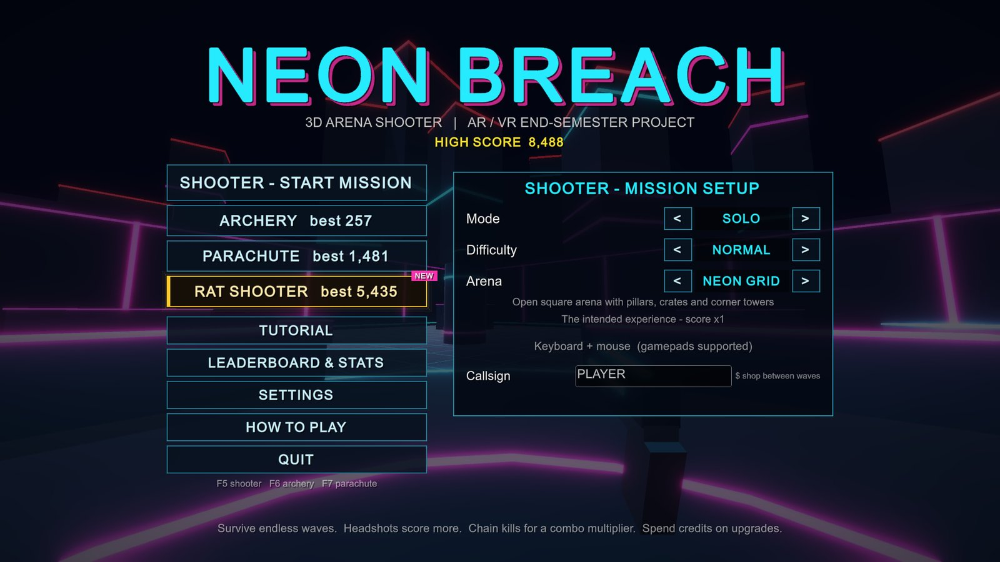

</div>

Neon Breach is one Unity project with **five playable games** that share one player, input, audio and HUD framework:

| # | Game | Scene | One-line pitch |
|---|------|-------|----------------|
| 1 | **Shooter** | `NeonBreach.unity` | Endless waves in a neon arena: 3 weapons, grenades, 6 enemy types with NavMesh AI, an upgrade shop between waves, power-ups, bosses, 2 arenas, local split-screen co-op |
| 2 | **Archery** | `NeonBreach.unity` | Neon range with static, rail and pop-up targets at 10-40 m: 3 rounds × 10 arrows, custom arrow ballistics with gravity, drag and wind |
| 3 | **Parachute** | `NeonBreach.unity` | Jump from a plane at 3,000 m over a procedural island: free fall with speed control, rings, ripcord, canopy flight, flare and a scored landing |
| 4 | **Rat Shooter** | `RatShooter.unity` | Sunny cartoon farmyard: shoot sneaky mice with personalities from the porch across 5 levels, with combo and headshot scoring |
| 5 | **Farm Sniper** | `FarmSniper.unity` | A farmer snipes the rats raiding his crops: bolt-action rifle with a 4x/8x/12x scope, simulated bullet drop and travel time, crop health |

Almost everything is **generated in code**: models, textures, materials, sounds, music, levels and the HUD. The repository holds no imported art or audio packs.

> **About the screenshots.** Every image in this README is an unedited frame from the actual game, captured on 22 Nov 2026 from the Unity Editor's Game view (1920×1080) in Play mode while the games were running. Frames were only resized to 1600×900 and saved as JPEG. A temporary capture script drove the session: it sent real Input System keyboard and mouse events, auto-aimed at targets (the same way the project's own `AutoTest` smoke test does) and fast-forwarded only the long canopy descent. No image is AI-generated, mocked up or rendered offline.

---

## Contents

1. [Architecture](#1-architecture)
   - [System overview](#11-system-overview) · [Scenes and navigation](#12-scenes-and-navigation) · [Game state machine](#13-core-game-state-machine) · [Mode switching](#14-mode-switching-lifecycle) · [Input abstraction](#15-input-abstraction) · [Rendering, content and audio](#16-procedural-content-rendering-and-audio-pipeline) · [Rat Shooter](#17-rat-shooter-architecture) · [Farm Sniper](#18-farm-sniper-architecture) · [Editor tooling and testing](#19-editor-tooling-build-and-test-workflow) · [Project structure](#110-project-structure)
2. [Gameplay walkthrough (screenshots)](#2-gameplay-walkthrough-screenshots)
   - [Main menu and settings](#21-main-menu-settings-and-localisation) · [Tutorial](#22-interactive-tutorial) · [Shooter](#23-shooter) · [Archery](#24-archery) · [Parachute](#25-parachute) · [Rat Shooter](#26-rat-shooter) · [Farm Sniper](#27-farm-sniper)
3. [Features](#3-features)
4. [Controls](#4-controls)
5. [Getting started](#5-getting-started)
6. [VR and mixed reality setup](#6-vr-and-mixed-reality-setup)
7. [Design decisions and optimisation](#7-design-decisions-and-optimisation)
8. [Testing](#8-testing)
9. [Known issues and limitations](#9-known-issues-and-limitations)
10. [Tech stack](#10-tech-stack)

---

## 1. Architecture

### 1.1 System overview

Every device writes into one `PlayerInputState` per player. Gameplay code reads only that state, so the same game runs on keyboard and mouse, gamepad, VR controllers and bare hands.

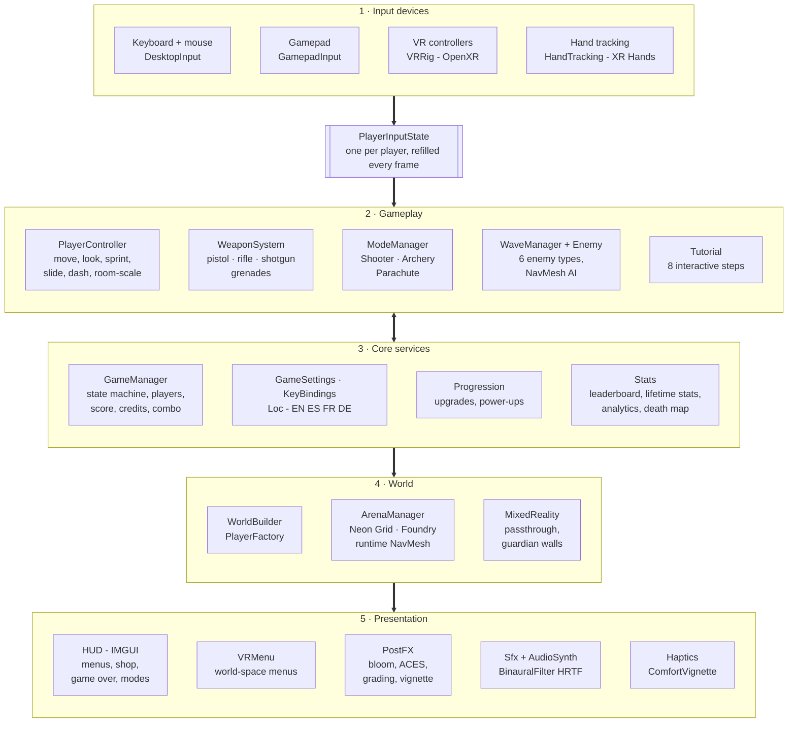

### 1.2 Scenes and navigation

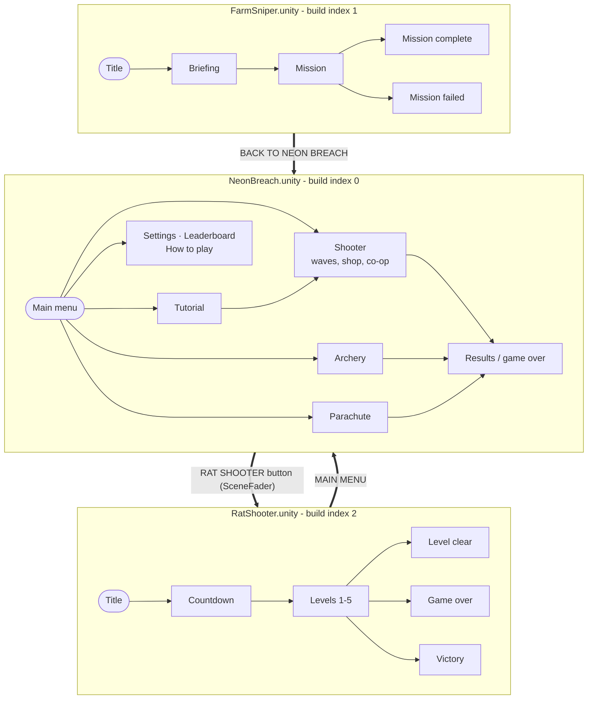

Farm Sniper is a standalone level. Open it from the editor menu **Neon Breach > Farm Sniper**; its title screen links back to Neon Breach. Rat Shooter starts from the gold **RAT SHOOTER** button on the main menu. `GameBootstrap` leaves both scenes alone because each contains a `StandaloneSceneMarker`.

### 1.3 Core game state machine

`GameManager` drives the shooter and hosts the mini-game runs (`BeginModeRun` / `EndModeRun`).

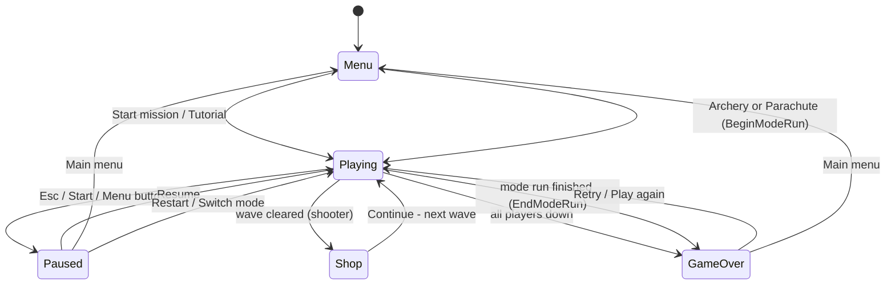

### 1.4 Mode switching lifecycle

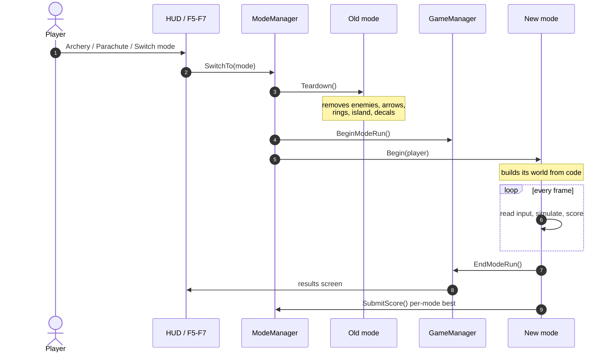

### 1.5 Input abstraction

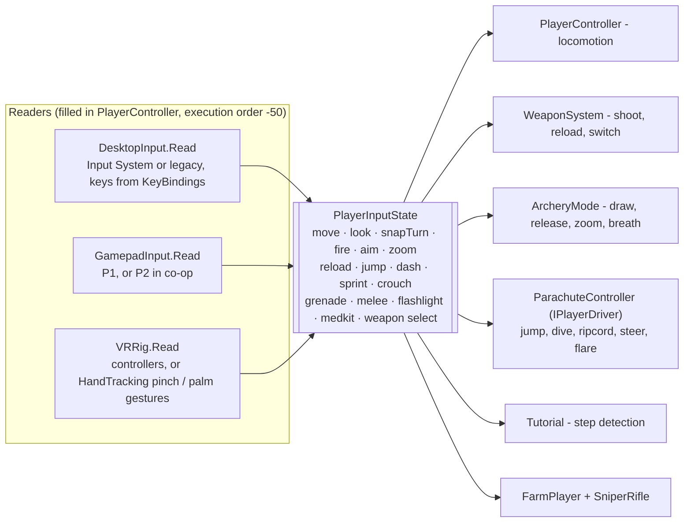

### 1.6 Procedural content, rendering and audio pipeline

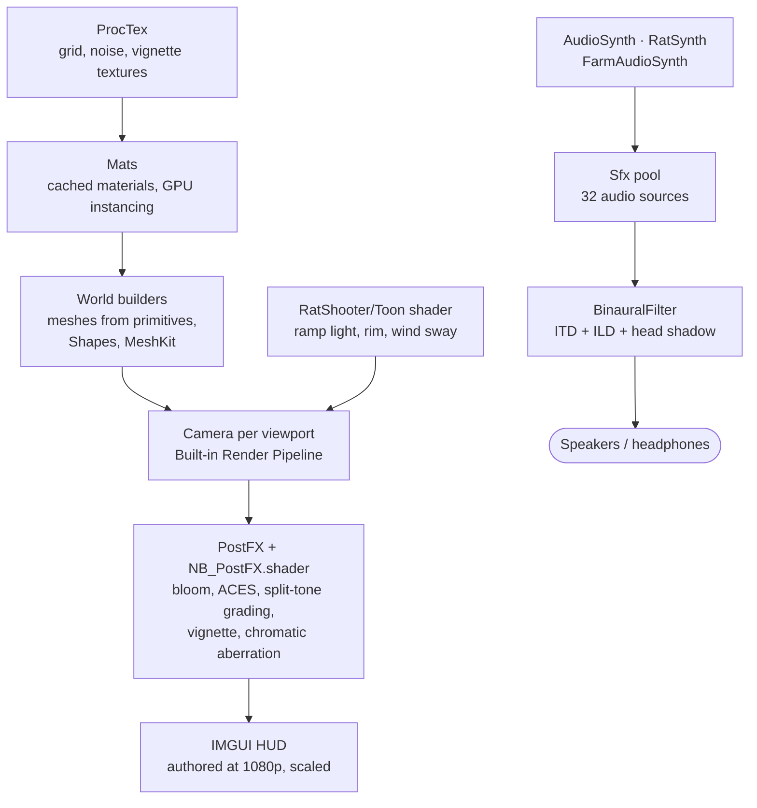

### 1.7 Rat Shooter architecture

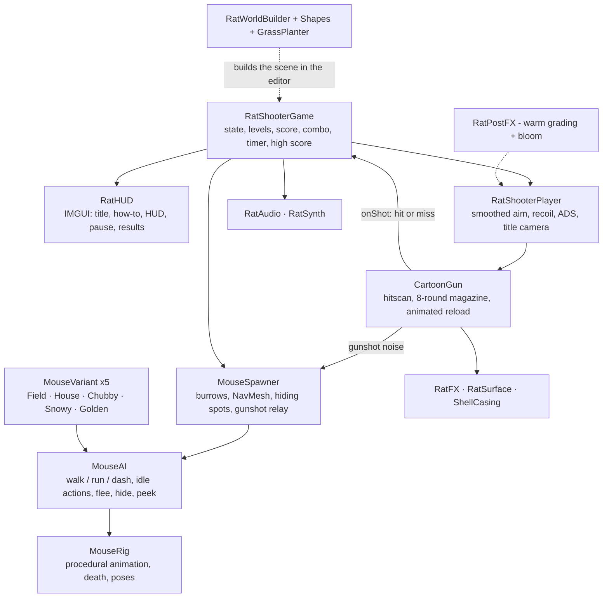

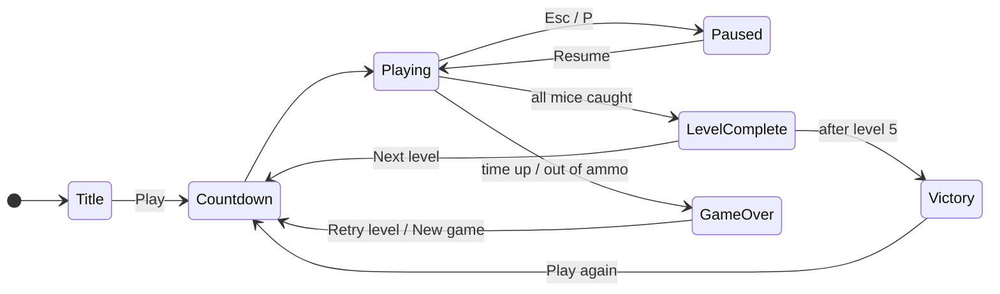

Mouse AI states (`MouseAI.State`): `Emerging → Moving ⇄ Idle / Eating → Alert → Fleeing → Hiding → Peeking → Moving`, plus `Submerging → Burrowed` (pops out of another burrow) and `Dying`.

### 1.8 Farm Sniper architecture

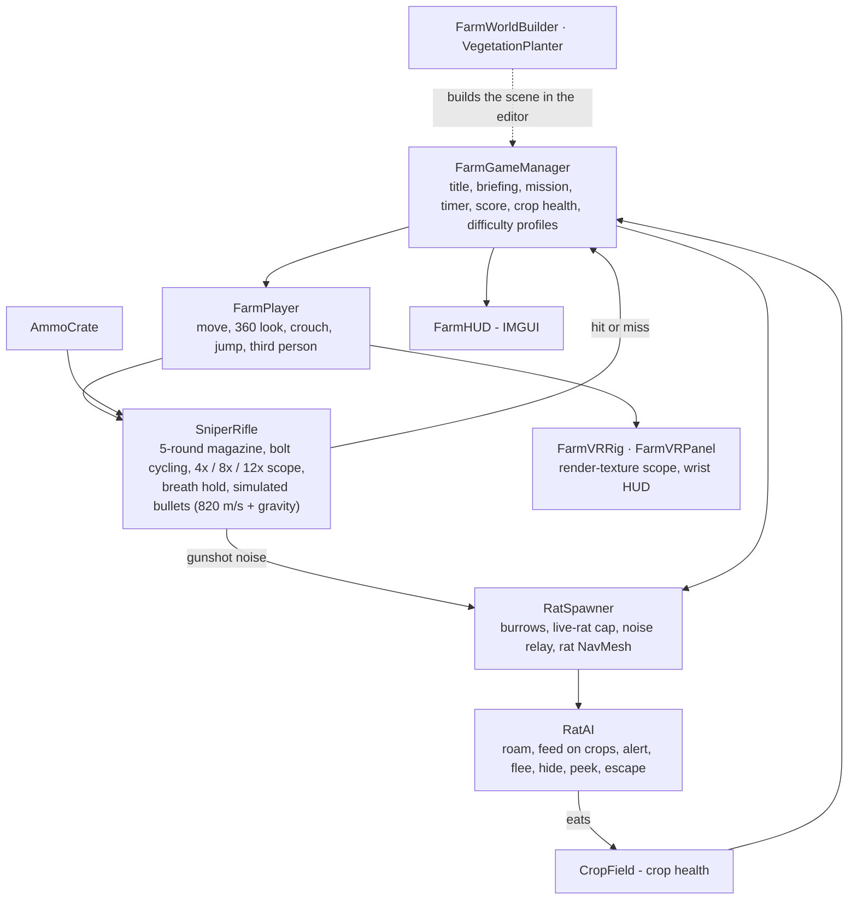

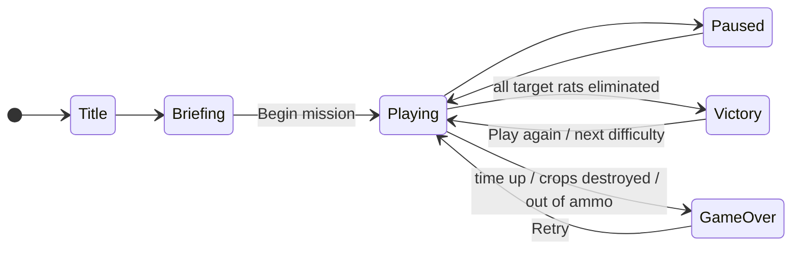

### 1.9 Editor tooling, build and test workflow

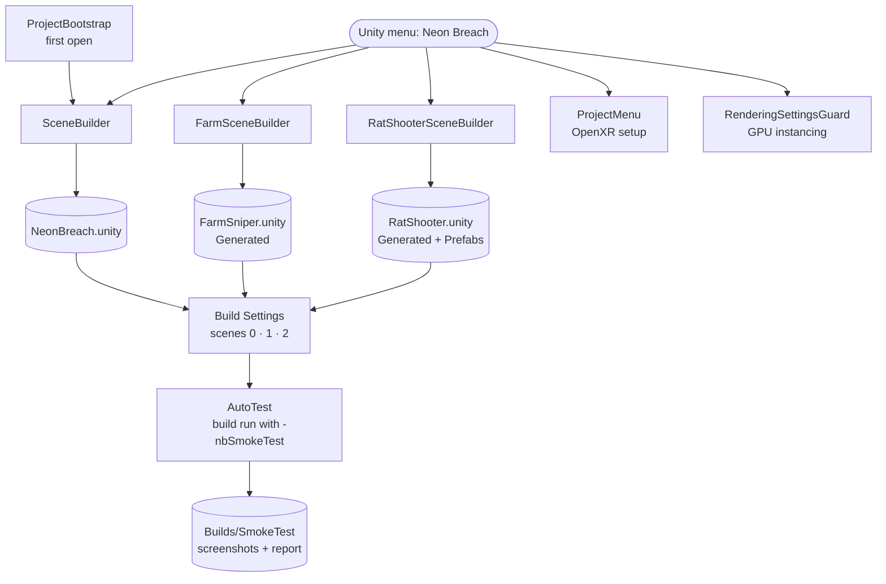

### 1.10 Project structure

```
NeonBreach/
├── Assets/
│   ├── Scenes/              NeonBreach.unity (0) · FarmSniper.unity (1) · RatShooter.unity (2)
│   ├── Scripts/             main game (namespace NeonBreach): 61 scripts, ~15.3k lines
│   │   ├── Core/            GameManager, GameSettings, KeyBindings, Loc, Progression, Stats, Sfx, AudioSynth,
│   │   │                    BinauralFilter, Haptics, Mats, ProcTex, Perf, Layers, HitZone, Util, AutoTest
│   │   ├── Player/          PlayerController, PlayerInputState, DesktopInput, GamepadInput, Tutorial, TrainingTarget
│   │   ├── Weapons/         WeaponSystem, WeaponStats, Grenade, FX
│   │   ├── Enemies/         Enemy, EnemyProjectile, Pickup, WaveManager
│   │   ├── Modes/           ModeManager, ArcheryMode, Arrow, ArcheryTarget, WindSystem, ParachuteMode,
│   │   │                    ParachuteController, SkydiveSettings, SkydiverRig, Ring, HUDModes
│   │   ├── UI/              HUD, HUDMenus, HUDShop, HUDGameOver (IMGUI partial class)
│   │   ├── VR/              VRRig, HandTracking, ComfortVignette, VRMenu, VRMenuDriver, MixedReality
│   │   ├── World/           WorldBuilder, ArenaManager, ArenaInfo, GameBootstrap
│   │   ├── Rendering/       PostFX
│   │   └── Editor/          SceneBuilder, ProjectBootstrap, ProjectMenu, RenderingSettingsGuard
│   ├── RatShooter/          cartoon game (namespace NeonBreach.RatShooter): 34 scripts, ~8.3k lines
│   │   ├── Scripts/         Core · Player · Mice · World · FX · UI · Audio · Rendering
│   │   ├── Shaders/         RatToon, RatSky, RatFX
│   │   ├── Editor/          RatShooterSceneBuilder
│   │   ├── Generated/       saved meshes, textures, materials
│   │   └── Prefabs/         5 mouse variants + rifle
│   ├── FarmSniper/          sniper game (namespace NeonBreach.Farm): 28 scripts, ~7.2k lines
│   │   ├── Scripts/         Gameplay · World · UI · VR · Audio
│   │   ├── Editor/          FarmSceneBuilder
│   │   └── Generated/       saved meshes, textures, materials, lighting, rat NavMesh
│   ├── Resources/           NB_PostFX + NB_Vignette shaders, shared materials and textures
│   ├── XR/                  XR Plug-in Management + OpenXR settings and loaders
│   └── CompositionLayers/   XR Composition Layers settings
├── Packages/                manifest.json + packages-lock.json
├── ProjectSettings/         Unity project settings (Input System only, 3 scenes in Build Settings)
└── Docs/
    ├── NEON_BREACH_Final_ESE_Project_Report.pdf
    ├── NeonBreach_ESE_Project_Report.pdf
    ├── NeonBreach_Project_Report.pdf / .docx
    ├── ESE_Report/          HTML/CSS/Mermaid source, editor & runtime captures, build/
    └── Screenshots/         menus · tutorial · shooter · archery · parachute · rat_shooter · farm_sniper
```

| Module | Responsibility | Key types |
|---|---|---|
| Core | Game state, settings, saving, scoring, audio, haptics, procedural assets | `GameManager`, `GameSettings`, `Stats`, `Progression`, `Sfx`, `BinauralFilter`, `Perf` |
| Player | Locomotion and all input readers | `PlayerController`, `PlayerInputState`, `DesktopInput`, `GamepadInput`, `Tutorial` |
| Weapons | Firing, reloading, switching, grenades, impact effects | `WeaponSystem`, `WeaponStats`, `Grenade`, `FX` |
| Enemies | Wave director, enemy AI, enemy projectiles, pickups | `WaveManager`, `Enemy`, `EnemyProjectile`, `Pickup` |
| Modes | Archery and Parachute mini-games and switching between modes | `ModeManager`, `MiniGame`, `ArcheryMode`, `ParachuteMode`, `ParachuteController` |
| UI | IMGUI HUD, menus, shop, game over and analytics | `HUD` (partial: `HUDMenus`, `HUDShop`, `HUDGameOver`, `HUDModes`) |
| VR | Headset rig, hand tracking, comfort, VR menus, passthrough | `VRRig`, `HandTracking`, `ComfortVignette`, `VRMenuDriver`, `MixedReality` |
| World | Arena generation, arena switching, runtime NavMesh | `WorldBuilder`, `ArenaManager`, `GameBootstrap` |
| Rendering | Post-processing on the Built-in pipeline | `PostFX`, `NB_PostFX.shader` |
| RatShooter | Separate cartoon game | `RatShooterGame`, `MouseAI`, `MouseRig`, `CartoonGun`, `RatHUD` |
| FarmSniper | Separate sniper game | `FarmGameManager`, `FarmPlayer`, `SniperRifle`, `RatAI`, `FarmHUD` |

---

## 2. Gameplay walkthrough (screenshots)

Click any image to open it at full size.

### 2.1 Main menu, settings and localisation

<table>
<tr>
<td width="50%" valign="top"><a href="Docs/Screenshots/menus/01_main_menu.jpg"></a><br><sub>Main menu: Shooter, Archery, Parachute and Rat Shooter (each shows its best score), tutorial, leaderboard, settings and how to play. Right: shooter mission setup</sub></td>
<td width="50%" valign="top"><a href="Docs/Screenshots/menus/02_mission_setup.jpg">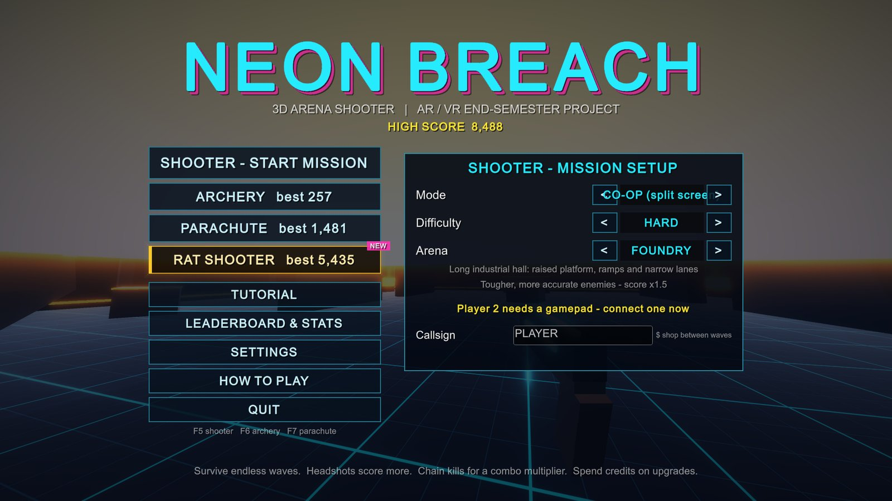</a><br><sub>Mission setup switched to co-op (split screen), Hard and the Foundry arena, which loads behind the menu. With no gamepad it warns that Player 2 needs one</sub></td>
</tr>
<tr>
<td width="50%" valign="top"><a href="Docs/Screenshots/menus/03_settings_gameplay.jpg">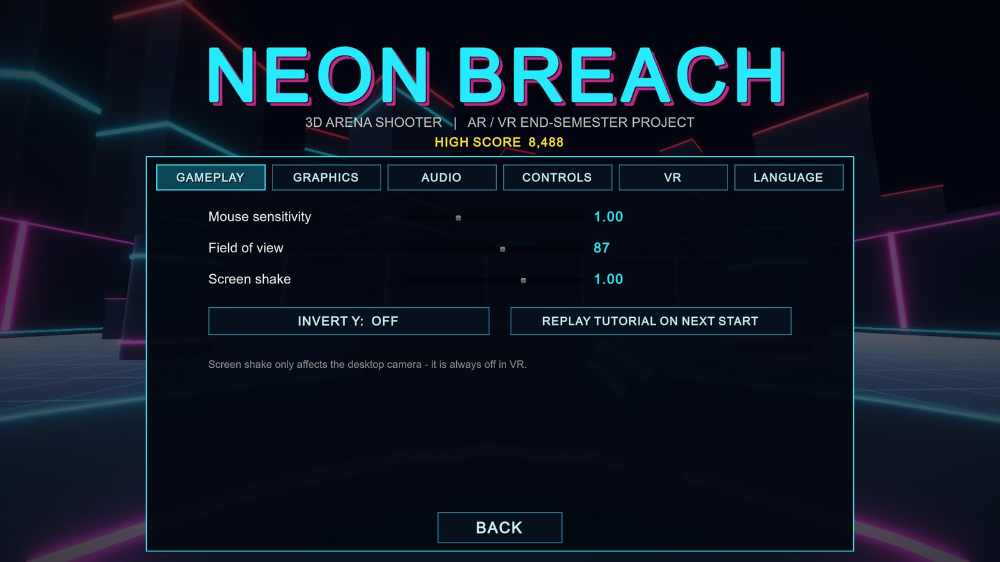</a><br><sub>Settings - Gameplay: mouse sensitivity, field of view, screen shake, invert Y, replay tutorial</sub></td>
<td width="50%" valign="top"><a href="Docs/Screenshots/menus/04_settings_graphics.jpg">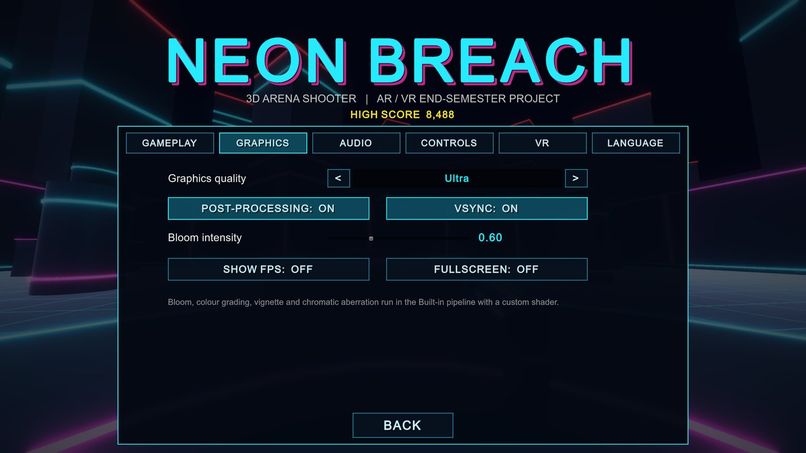</a><br><sub>Settings - Graphics: quality level, post-processing, VSync, bloom intensity, FPS counter, fullscreen</sub></td>
</tr>
<tr>
<td width="50%" valign="top"><a href="Docs/Screenshots/menus/05_settings_audio.jpg">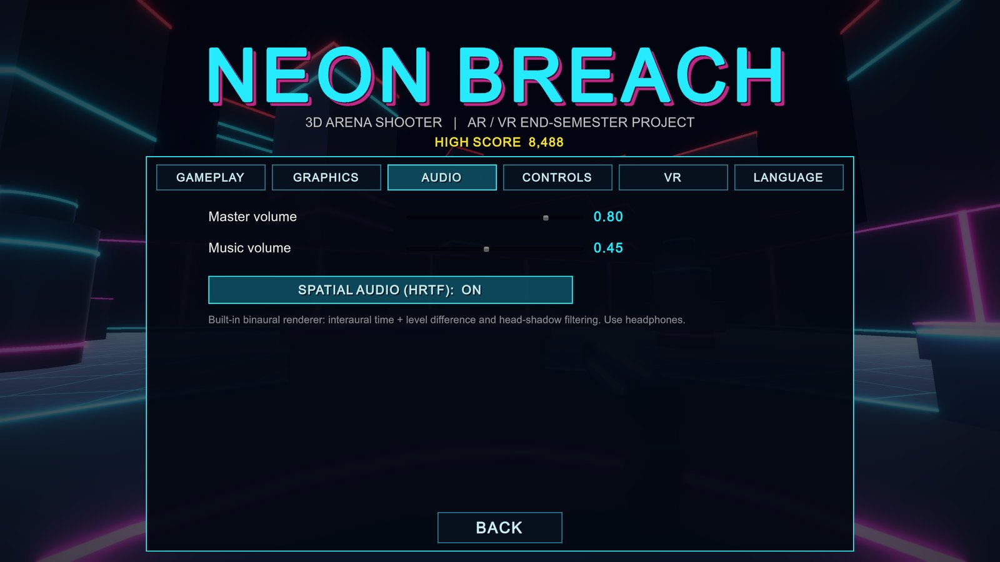</a><br><sub>Settings - Audio: master and music volume, HRTF spatial audio</sub></td>
<td width="50%" valign="top"><a href="Docs/Screenshots/menus/06_settings_controls_rebinding.jpg">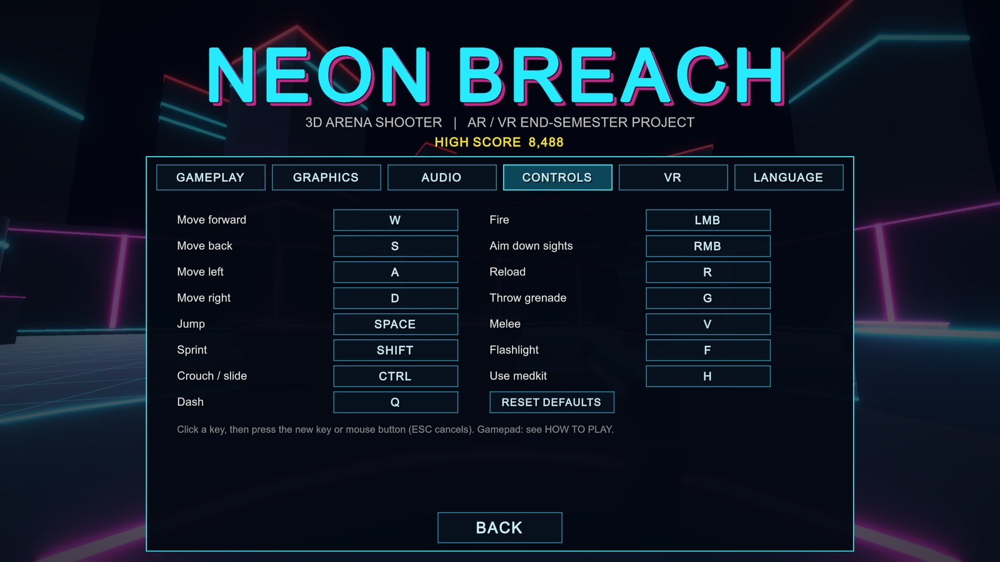</a><br><sub>Settings - Controls: every action can be rebound to any key or mouse button</sub></td>
</tr>
<tr>
<td width="50%" valign="top"><a href="Docs/Screenshots/menus/07_settings_vr_comfort.jpg">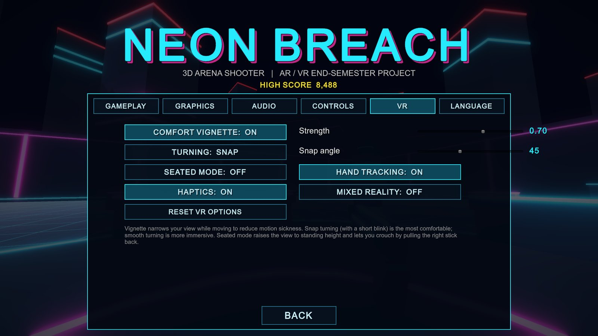</a><br><sub>Settings - VR: comfort vignette, snap / smooth turning, seated mode, haptics, hand tracking, mixed reality</sub></td>
<td width="50%" valign="top"><a href="Docs/Screenshots/menus/08_settings_language.jpg">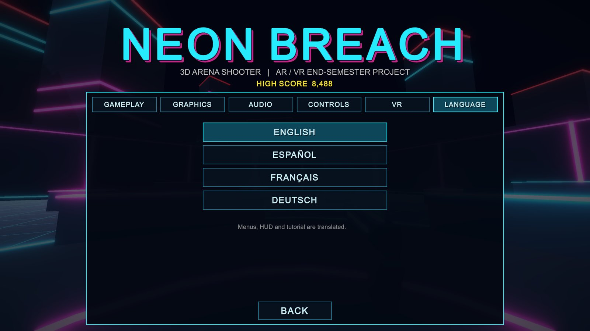</a><br><sub>Settings - Language: English, Español, Français, Deutsch (menus, HUD and tutorial)</sub></td>
</tr>
<tr>
<td width="50%" valign="top"><a href="Docs/Screenshots/menus/09_how_to_play.jpg">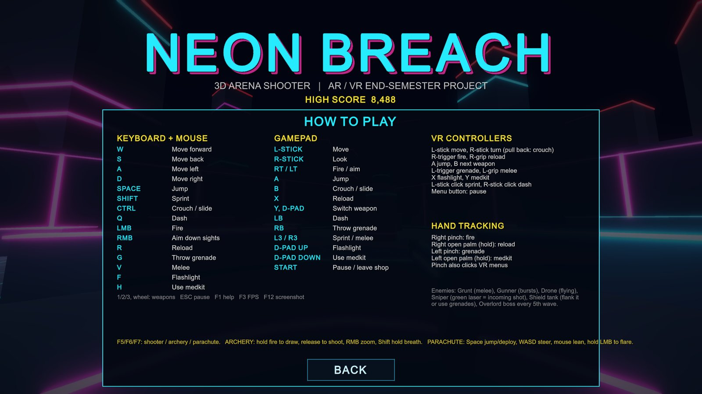</a><br><sub>How to play: keyboard + mouse, gamepad, VR controller and hand-tracking controls</sub></td>
<td width="50%" valign="top"><a href="Docs/Screenshots/menus/10_leaderboard_stats.jpg">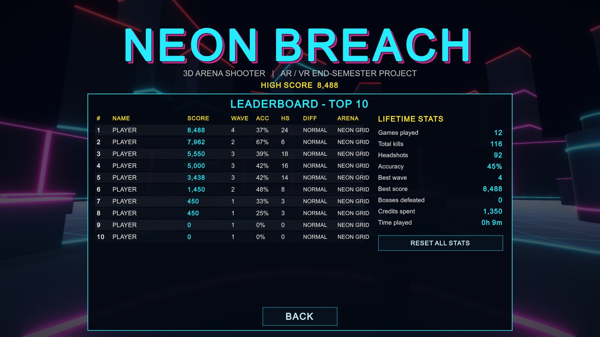</a><br><sub>Leaderboard (top 10 runs) and lifetime stats</sub></td>
</tr>
<tr>
<td width="50%" valign="top"><a href="Docs/Screenshots/menus/11_menu_spanish.jpg">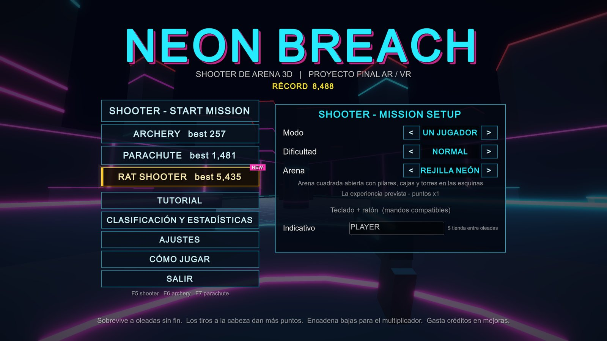</a><br><sub>Main menu in Spanish</sub></td>
<td width="50%" valign="top"><a href="Docs/Screenshots/menus/12_menu_french.jpg">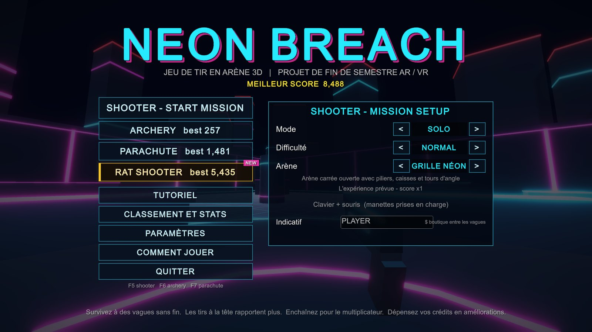</a><br><sub>Main menu in French</sub></td>
</tr>
<tr>
<td width="50%" valign="top"><a href="Docs/Screenshots/menus/13_menu_german.jpg">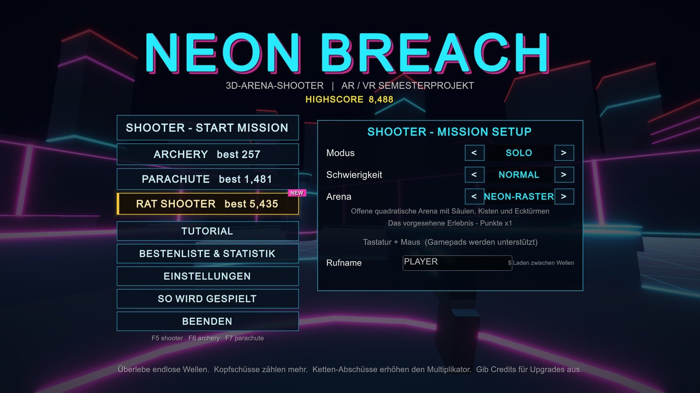</a><br><sub>Main menu in German</sub></td>
<td width="50%"></td>
</tr>
</table>

### 2.2 Interactive tutorial

The first-run tutorial adapts its prompts to keyboard, gamepad, VR controllers or hands. Each step finishes only when the player actually performs the action.

<table>
<tr>
<td width="50%" valign="top"><a href="Docs/Screenshots/tutorial/01_look_around.jpg">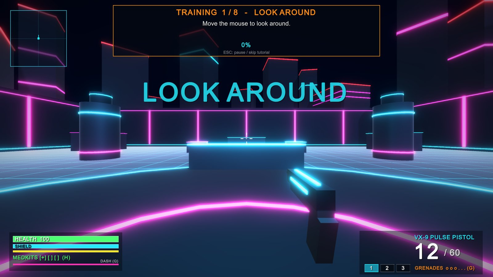</a><br><sub>Step 1/8 - look around</sub></td>
<td width="50%" valign="top"><a href="Docs/Screenshots/tutorial/02_sprint_jump.jpg">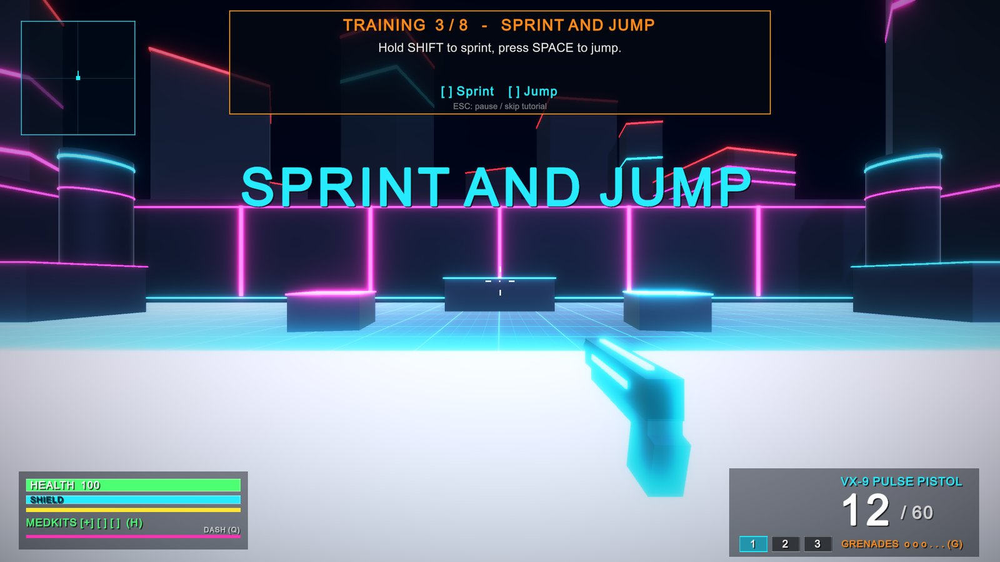</a><br><sub>Step 3/8 - sprint and jump (walking forward completed step 2)</sub></td>
</tr>
<tr>
<td width="50%" valign="top"><a href="Docs/Screenshots/tutorial/03_shoot_targets.jpg">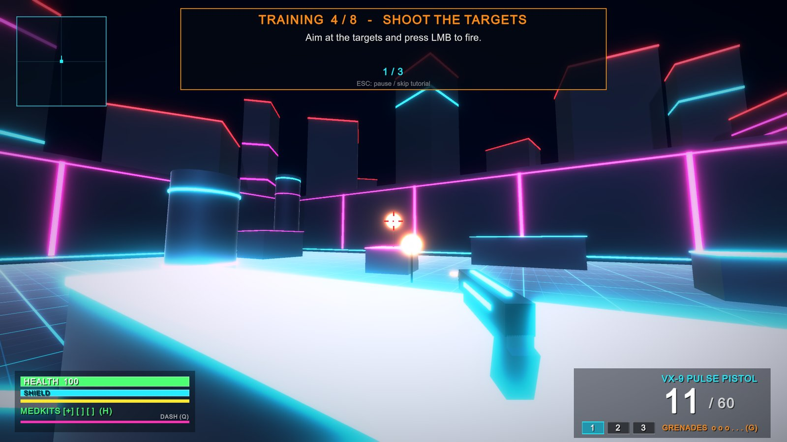</a><br><sub>Step 4/8 - shoot the training targets (first target hit: 1/3)</sub></td>
<td width="50%" valign="top"><a href="Docs/Screenshots/tutorial/04_aim_down_sights.jpg">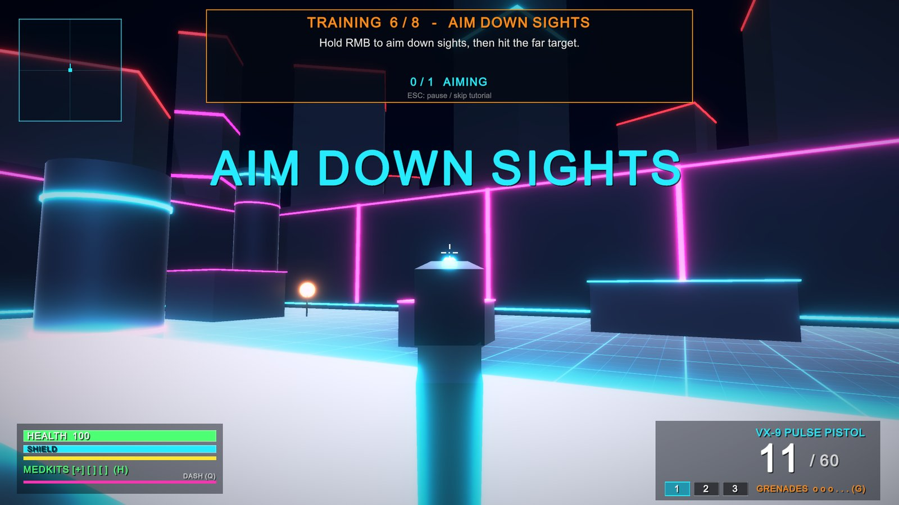</a><br><sub>Step 6/8 - aim down the sights at the far target</sub></td>
</tr>
<tr>
<td width="50%" valign="top"><a href="Docs/Screenshots/tutorial/05_grenade.jpg">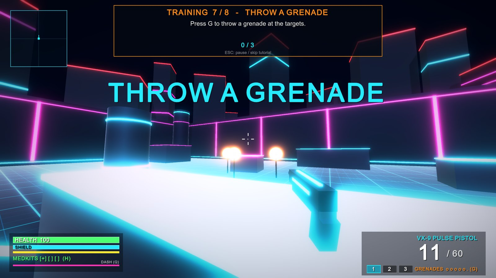</a><br><sub>Step 7/8 - throw a grenade at the targets</sub></td>
<td width="50%" valign="top"><a href="Docs/Screenshots/tutorial/06_power_ups.jpg">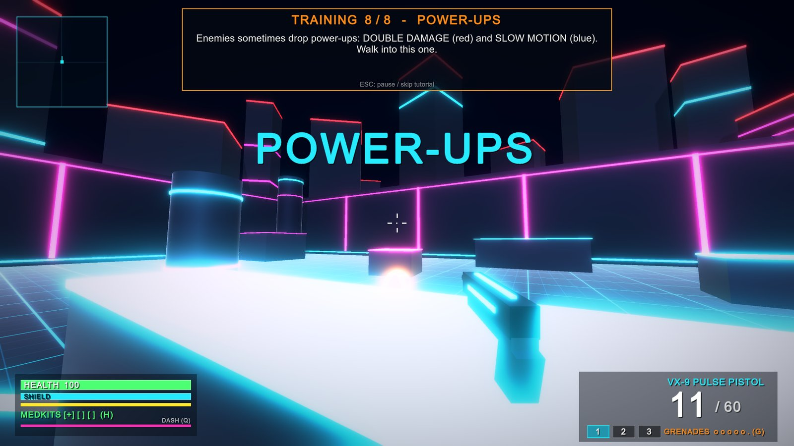</a><br><sub>Step 8/8 - walk into a power-up</sub></td>
</tr>
</table>

### 2.3 Shooter

Waves, three weapons, grenades, the between-wave shop, special enemies, power-ups, menus, analytics, the second arena and split-screen co-op.

<table>
<tr>
<td width="50%" valign="top"><a href="Docs/Screenshots/shooter/01_wave_start.jpg">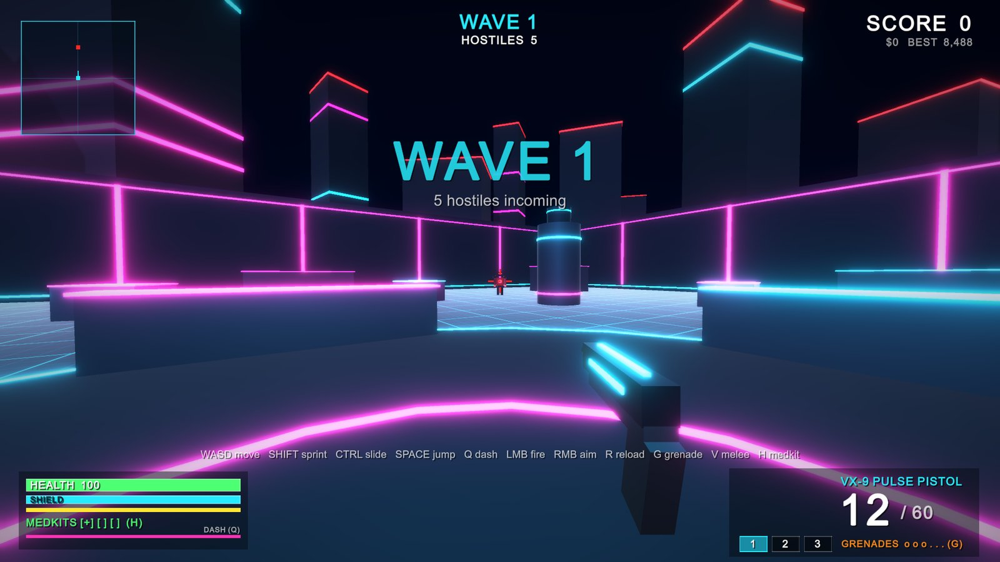</a><br><sub>Wave 1 - 5 hostiles incoming. HUD: radar, health / shield / medkits, ammo and weapon slots</sub></td>
<td width="50%" valign="top"><a href="Docs/Screenshots/shooter/02_pistol.jpg">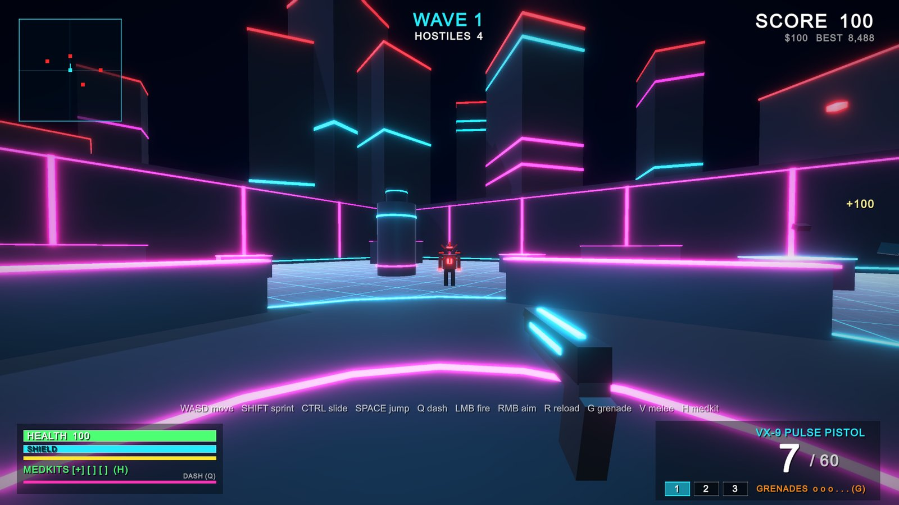</a><br><sub>VX-9 Pulse Pistol: headshot score popups</sub></td>
</tr>
<tr>
<td width="50%" valign="top"><a href="Docs/Screenshots/shooter/03_plasma_rifle.jpg">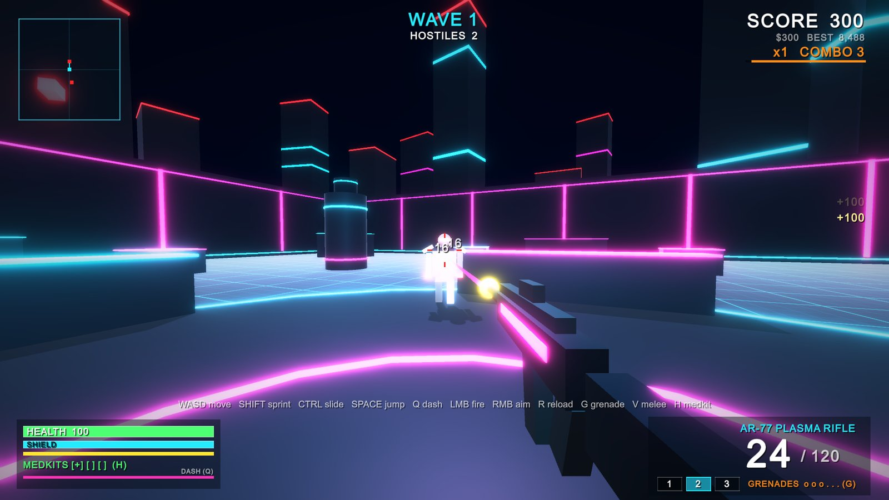</a><br><sub>AR-77 Plasma Rifle (full auto) with the combo multiplier (top right)</sub></td>
<td width="50%" valign="top"><a href="Docs/Screenshots/shooter/04_aim_down_sights.jpg">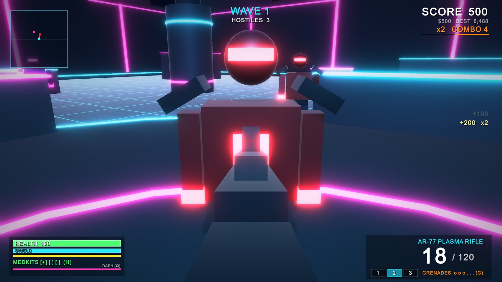</a><br><sub>Aiming down the sights at a Gunner</sub></td>
</tr>
<tr>
<td width="50%" valign="top"><a href="Docs/Screenshots/shooter/05_scatter_cannon.jpg">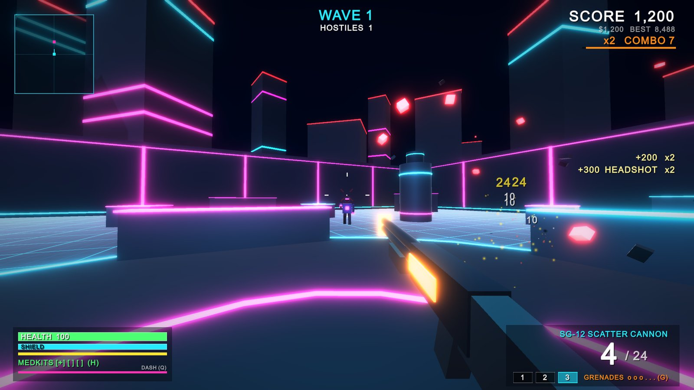</a><br><sub>SG-12 Scatter Cannon</sub></td>
<td width="50%" valign="top"><a href="Docs/Screenshots/shooter/06_grenade_explosion.jpg">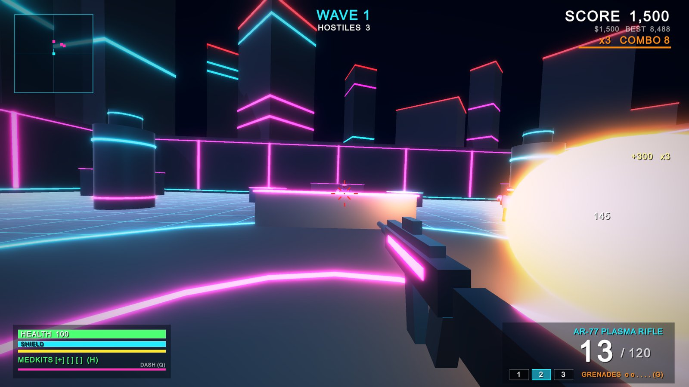</a><br><sub>Grenade explosion</sub></td>
</tr>
<tr>
<td width="50%" valign="top"><a href="Docs/Screenshots/shooter/07_shop_armory.jpg">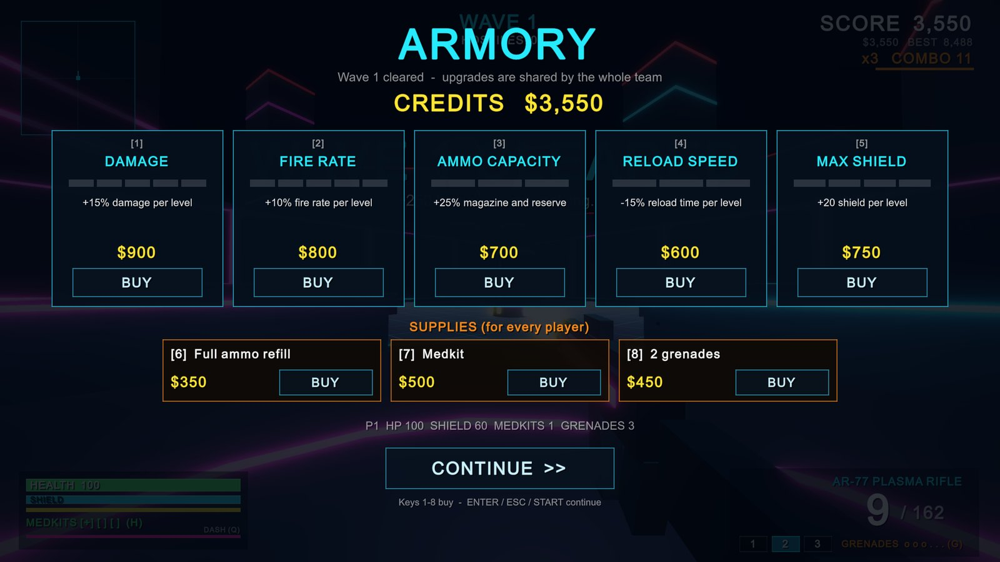</a><br><sub>ARMORY between waves: upgrades and supplies paid with the credits earned from kills</sub></td>
<td width="50%" valign="top"><a href="Docs/Screenshots/shooter/08_shop_upgrade_bought.jpg">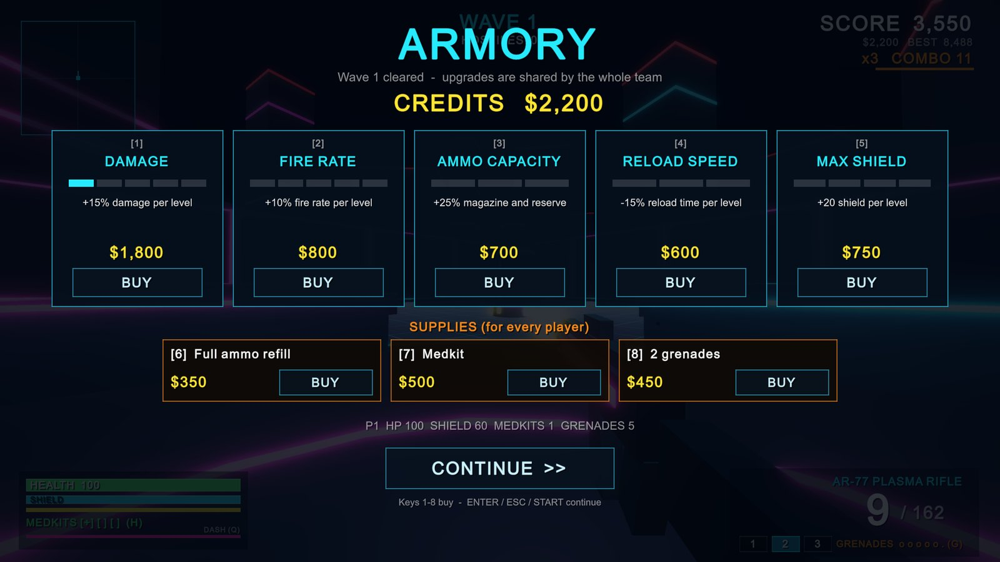</a><br><sub>Damage upgrade bought: the level bar fills and the price rises</sub></td>
</tr>
<tr>
<td width="50%" valign="top"><a href="Docs/Screenshots/shooter/09_shield_tank.jpg">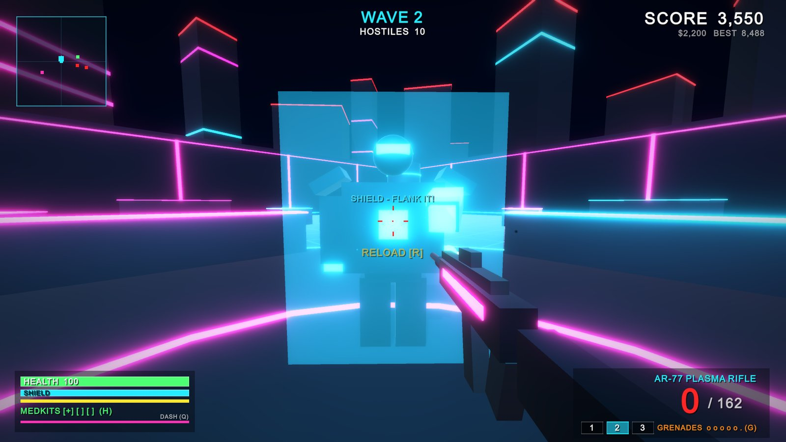</a><br><sub>Shield Tank: its frontal energy shield blocks bullets - flank it or use grenades</sub></td>
<td width="50%" valign="top"><a href="Docs/Screenshots/shooter/10_power_up_slow_motion.jpg">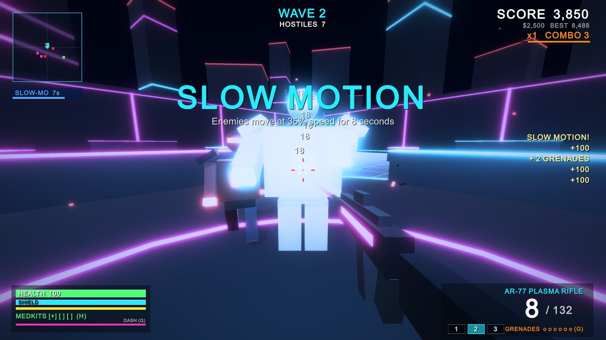</a><br><sub>Slow Motion power-up: only enemies and their bolts slow down (cold tint)</sub></td>
</tr>
<tr>
<td width="50%" valign="top"><a href="Docs/Screenshots/shooter/11_power_up_double_damage.jpg">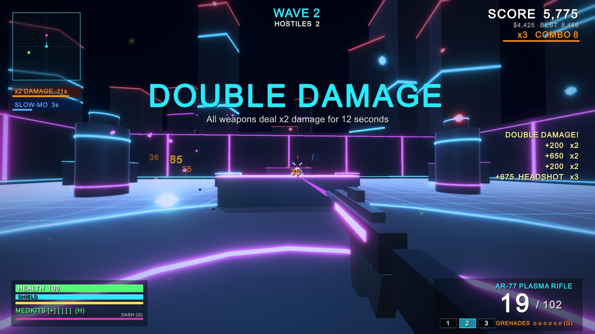</a><br><sub>Double Damage power-up (warm tint, x2 damage)</sub></td>
<td width="50%" valign="top"><a href="Docs/Screenshots/shooter/12_boss_overlord.jpg">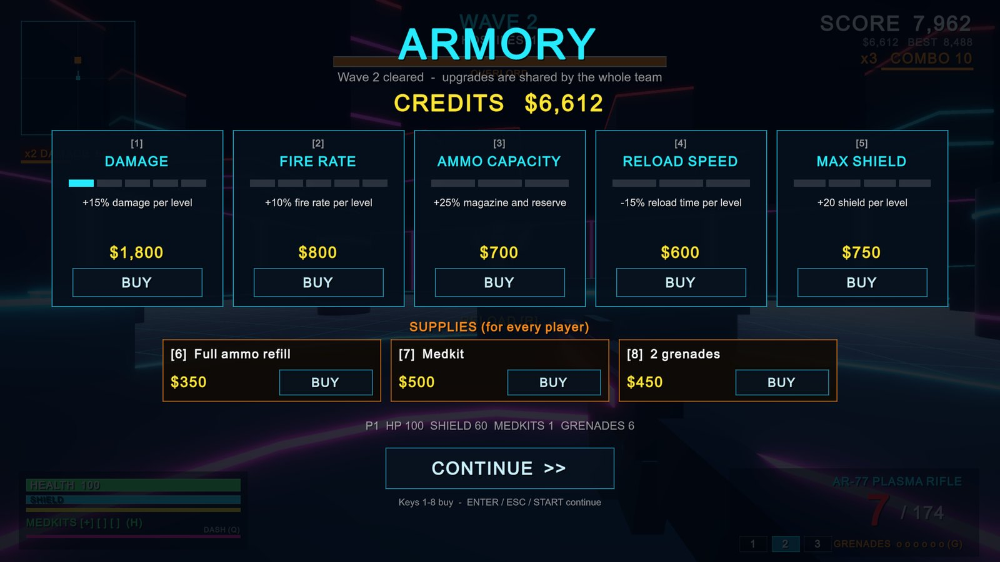</a><br><sub>OVERLORD boss with its health bar</sub></td>
</tr>
<tr>
<td width="50%" valign="top"><a href="Docs/Screenshots/shooter/13_drones.jpg"></a><br><sub>Drones and gunners firing bolts</sub></td>
<td width="50%" valign="top"><a href="Docs/Screenshots/shooter/14_help_overlay_f1.jpg">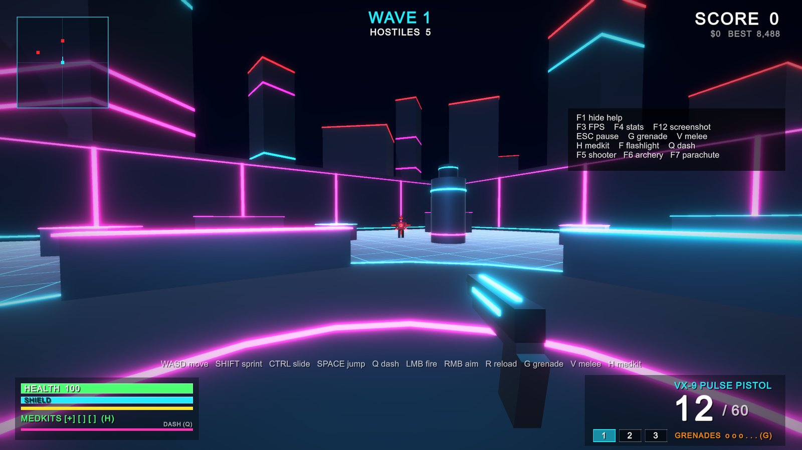</a><br><sub>F1 help overlay</sub></td>
</tr>
<tr>
<td width="50%" valign="top"><a href="Docs/Screenshots/shooter/15_performance_panel_f4.jpg">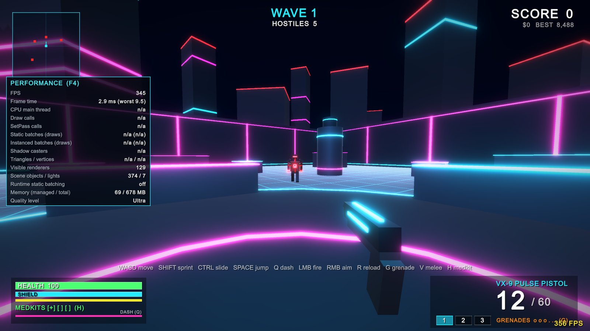</a><br><sub>F4 performance panel (FPS, frame time, batches, triangles, memory) and the F3 FPS counter</sub></td>
<td width="50%" valign="top"><a href="Docs/Screenshots/shooter/16_pause_menu.jpg">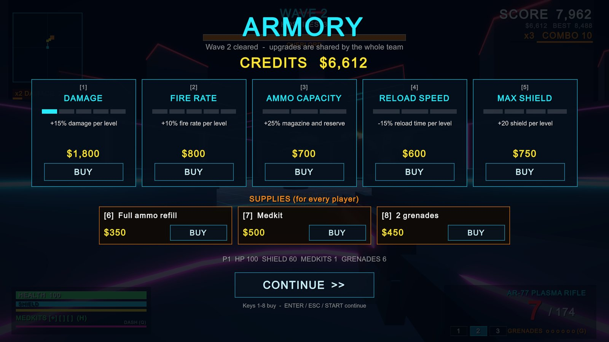</a><br><sub>Pause menu</sub></td>
</tr>
<tr>
<td width="50%" valign="top"><a href="Docs/Screenshots/shooter/17_switch_mode.jpg">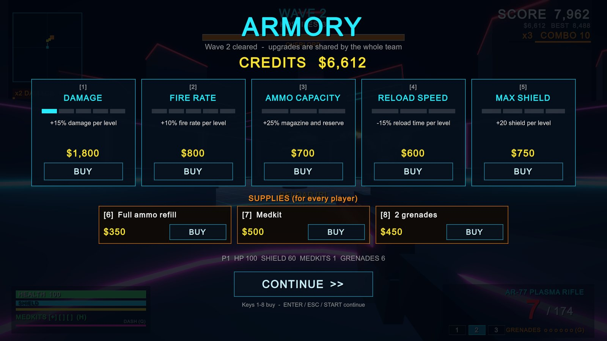</a><br><sub>Pause - Switch mode: each mode keeps its own best score</sub></td>
<td width="50%" valign="top"><a href="Docs/Screenshots/shooter/18_pause_settings.jpg">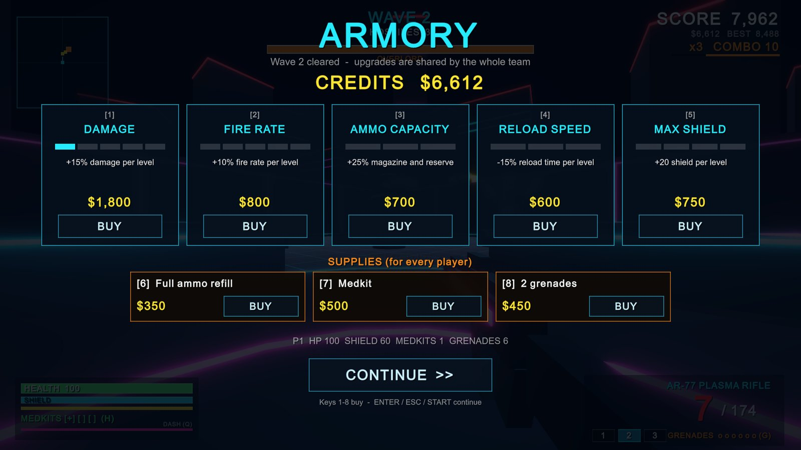</a><br><sub>Settings opened from the pause menu</sub></td>
</tr>
<tr>
<td width="50%" valign="top"><a href="Docs/Screenshots/shooter/19_game_over_summary.jpg">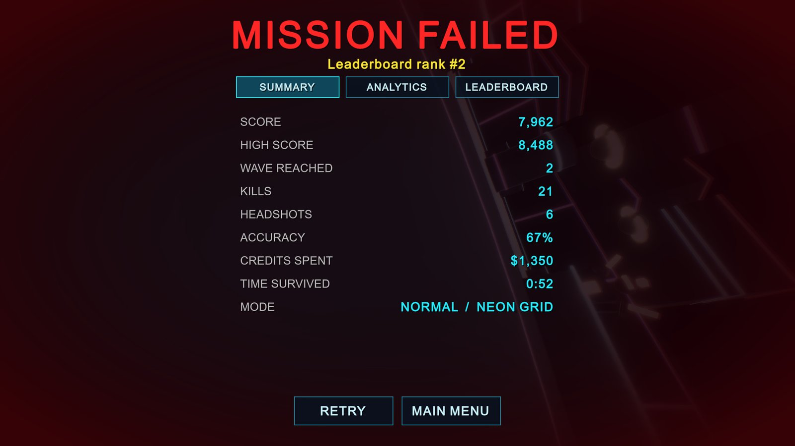</a><br><sub>Game over - run summary (this run ranked #2 on the leaderboard)</sub></td>
<td width="50%" valign="top"><a href="Docs/Screenshots/shooter/20_game_over_analytics.jpg">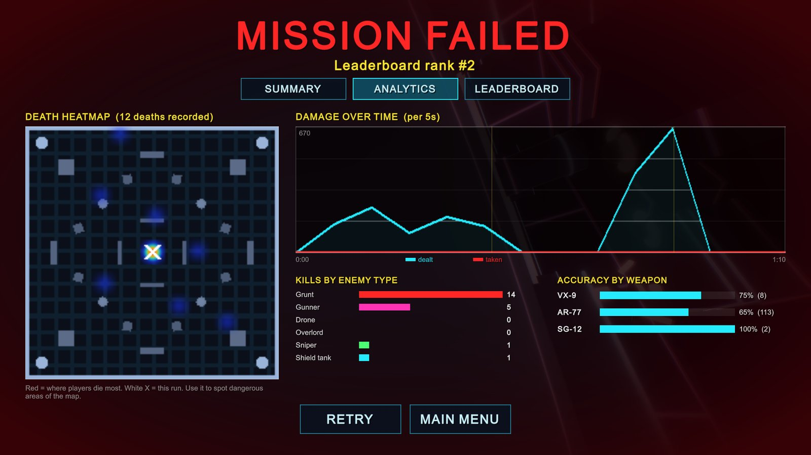</a><br><sub>Game over - analytics: death heat map over the arena, damage dealt vs taken over time, kills per enemy type, accuracy per weapon</sub></td>
</tr>
<tr>
<td width="50%" valign="top"><a href="Docs/Screenshots/shooter/21_game_over_leaderboard.jpg">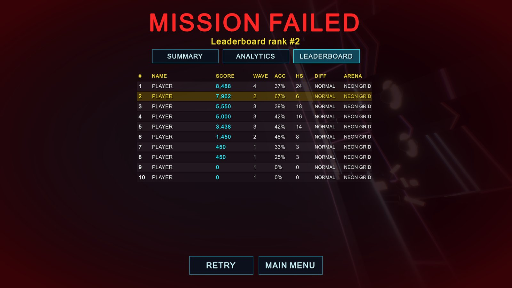</a><br><sub>Game over - leaderboard with the new run highlighted</sub></td>
<td width="50%" valign="top"><a href="Docs/Screenshots/shooter/22_foundry_arena.jpg"></a><br><sub>Second arena, Foundry: a long industrial hall with ramps, lanes and a raised platform</sub></td>
</tr>
<tr>
<td width="50%" valign="top"><a href="Docs/Screenshots/shooter/23_foundry_sprint.jpg"></a><br><sub>Sprinting through the Foundry</sub></td>
<td width="50%" valign="top"><a href="Docs/Screenshots/shooter/24_coop_split_screen.jpg"></a><br><sub>Local split-screen co-op: P1 keyboard + mouse (left), P2 gamepad (right; no gamepad was connected, so it asks for one)</sub></td>
</tr>
<tr>
<td width="50%" valign="top"><a href="Docs/Screenshots/shooter/25_coop_wave_cleared_revive.jpg"></a><br><sub>Co-op wave cleared: the downed partner is back in the fight</sub></td>
<td width="50%"></td>
</tr>
</table>

### 2.4 Archery

Three rounds of ten arrows. Wind changes every round. Moving targets and streaks multiply the score.

<table>
<tr>
<td width="50%" valign="top"><a href="Docs/Screenshots/archery/01_range_overview.jpg"></a><br><sub>The neon range: targets at 10 / 20 / 30 / 40 m, wind indicator (top left), round and arrows left</sub></td>
<td width="50%" valign="top"><a href="Docs/Screenshots/archery/02_full_draw.jpg"></a><br><sub>Bow at full draw (draw meter under the crosshair)</sub></td>
</tr>
<tr>
<td width="50%" valign="top"><a href="Docs/Screenshots/archery/03_zoom_hold_breath.jpg"></a><br><sub>Zoomed (RMB) and holding breath (Shift) to steady the sway</sub></td>
<td width="50%" valign="top"><a href="Docs/Screenshots/archery/04_bullseye_streak.jpg"></a><br><sub>Bullseye +60 with a streak bonus</sub></td>
</tr>
<tr>
<td width="50%" valign="top"><a href="Docs/Screenshots/archery/05_moving_target_bonus.jpg"></a><br><sub>Bullseye on a moving rail target: x1.5 bonus on top of the streak</sub></td>
<td width="50%" valign="top"><a href="Docs/Screenshots/archery/06_zoom_round3_strong_wind.jpg"></a><br><sub>Round 3: the wind rises to 6.6 m/s</sub></td>
</tr>
<tr>
<td width="50%" valign="top"><a href="Docs/Screenshots/archery/07_round_summary.jpg"></a><br><sub>Round summary: the score of every arrow</sub></td>
<td width="50%" valign="top"><a href="Docs/Screenshots/archery/08_final_results.jpg"></a><br><sub>Final results: 30/30 hits, 27 bullseyes, new best score</sub></td>
</tr>
</table>

### 2.5 Parachute

A complete skydive from the plane door to the landing pad.

<table>
<tr>
<td width="50%" valign="top"><a href="Docs/Screenshots/parachute/01_in_the_plane.jpg"></a><br><sub>In the plane door at 3,000 m. HUD: altimeter, speed, parachute status, mini-map to the landing pad</sub></td>
<td width="50%" valign="top"><a href="Docs/Screenshots/parachute/02_green_light.jpg"></a><br><sub>Green light - jump! [SPACE]</sub></td>
</tr>
<tr>
<td width="50%" valign="top"><a href="Docs/Screenshots/parachute/03_exit.jpg"></a><br><sub>Exit - free fall begins</sub></td>
<td width="50%" valign="top"><a href="Docs/Screenshots/parachute/04_freefall_belly.jpg"></a><br><sub>Belly-to-earth free fall with the third-person chase camera</sub></td>
</tr>
<tr>
<td width="50%" valign="top"><a href="Docs/Screenshots/parachute/05_head_down_dive.jpg"></a><br><sub>Head-down dive (hold Shift): 224 km/h</sub></td>
<td width="50%" valign="top"><a href="Docs/Screenshots/parachute/06_spread_eagle.jpg"></a><br><sub>Spread eagle (hold Ctrl): slower fall</sub></td>
</tr>
<tr>
<td width="50%" valign="top"><a href="Docs/Screenshots/parachute/07_freefall_first_person.jpg"></a><br><sub>First-person free fall (V)</sub></td>
<td width="50%" valign="top"><a href="Docs/Screenshots/parachute/08_open_parachute_button.jpg"></a><br><sub>Below 2,000 m the OPEN PARACHUTE button appears</sub></td>
</tr>
<tr>
<td width="50%" valign="top"><a href="Docs/Screenshots/parachute/09_deploying.jpg"></a><br><sub>Canopy deploying</sub></td>
<td width="50%" valign="top"><a href="Docs/Screenshots/parachute/10_canopy_flight.jpg"></a><br><sub>Canopy flight: steer, front risers, brakes</sub></td>
</tr>
<tr>
<td width="50%" valign="top"><a href="Docs/Screenshots/parachute/11_final_approach_pad.jpg"></a><br><sub>Final approach to the landing pad and its beacon</sub></td>
<td width="50%" valign="top"><a href="Docs/Screenshots/parachute/12_flare.jpg"></a><br><sub>Flare before touchdown (hold LMB)</sub></td>
</tr>
<tr>
<td width="50%" valign="top"><a href="Docs/Screenshots/parachute/13_landed.jpg"></a><br><sub>Landed near the pad</sub></td>
<td width="50%" valign="top"><a href="Docs/Screenshots/parachute/14_results.jpg"></a><br><sub>Results: rings, coins, landing accuracy, softness, time bonus</sub></td>
</tr>
</table>

### 2.6 Rat Shooter

Launched from the main menu with a fade. Five levels of increasingly sneaky cartoon mice.

<table>
<tr>
<td width="50%" valign="top"><a href="Docs/Screenshots/rat_shooter/01_title.jpg"></a><br><sub>Title screen: mice wander behind it; difficulty Easy / Normal / Hard</sub></td>
<td width="50%" valign="top"><a href="Docs/Screenshots/rat_shooter/02_how_to_play.jpg"></a><br><sub>How to play: controls and the five kinds of mice</sub></td>
</tr>
<tr>
<td width="50%" valign="top"><a href="Docs/Screenshots/rat_shooter/03_countdown.jpg"></a><br><sub>Level intro and 3-2-1 countdown</sub></td>
<td width="50%" valign="top"><a href="Docs/Screenshots/rat_shooter/04_gameplay_hud.jpg"></a><br><sub>Gameplay HUD: score, timer, mice left, pause button, ammo</sub></td>
</tr>
<tr>
<td width="50%" valign="top"><a href="Docs/Screenshots/rat_shooter/05_aim_down_sights.jpg"></a><br><sub>Aiming down the sights</sub></td>
<td width="50%" valign="top"><a href="Docs/Screenshots/rat_shooter/06_headshot.jpg"></a><br><sub>HEADSHOT! +150</sub></td>
</tr>
<tr>
<td width="50%" valign="top"><a href="Docs/Screenshots/rat_shooter/07_near_miss_mice_flee.jpg"></a><br><sub>MISSED! The spooked mice run for cover</sub></td>
<td width="50%" valign="top"><a href="Docs/Screenshots/rat_shooter/08_reload.jpg"></a><br><sub>Animated reload</sub></td>
</tr>
<tr>
<td width="50%" valign="top"><a href="Docs/Screenshots/rat_shooter/09_pause.jpg"></a><br><sub>Pause menu with mouse sensitivity</sub></td>
<td width="50%" valign="top"><a href="Docs/Screenshots/rat_shooter/10_level_clear_stars.jpg"></a><br><sub>Level 1 clear: time, ammo and accuracy bonuses, 3 stars</sub></td>
</tr>
<tr>
<td width="50%" valign="top"><a href="Docs/Screenshots/rat_shooter/11_level2.jpg"></a><br><sub>Level 2 - Hungry Visitors</sub></td>
<td width="50%" valign="top"><a href="Docs/Screenshots/rat_shooter/12_game_over.jpg"></a><br><sub>Game over - time's up!</sub></td>
</tr>
<tr>
<td width="50%" valign="top"><a href="Docs/Screenshots/rat_shooter/13_level5.jpg"></a><br><sub>Level 5 - The Big Squeak (20 mice)</sub></td>
<td width="50%" valign="top"><a href="Docs/Screenshots/rat_shooter/14_victory.jpg"></a><br><sub>Victory: Farm saved! Trophy, confetti and a new high score</sub></td>
</tr>
<tr>
<td width="50%" valign="top"><a href="Docs/Screenshots/rat_shooter/15_back_on_main_menu.jpg"></a><br><sub>Back on the Neon Breach main menu; the RAT SHOOTER button shows the new best</sub></td>
<td width="50%"></td>
</tr>
</table>

### 2.7 Farm Sniper

Protect the crops: eliminate 15 rats before time runs out.

<table>
<tr>
<td width="50%" valign="top"><a href="Docs/Screenshots/farm_sniper/01_title.jpg"></a><br><sub>Title: difficulty, controls, back to Neon Breach</sub></td>
<td width="50%" valign="top"><a href="Docs/Screenshots/farm_sniper/02_briefing.jpg"></a><br><sub>Mission briefing: objective, intel and scoring</sub></td>
</tr>
<tr>
<td width="50%" valign="top"><a href="Docs/Screenshots/farm_sniper/03_gameplay_watchtower.jpg"></a><br><sub>On the farm by the watchtower. HUD: rats left, crop health, score, accuracy, ammo</sub></td>
<td width="50%" valign="top"><a href="Docs/Screenshots/farm_sniper/04_scope.jpg"></a><br><sub>Scope view (4x / 8x / 12x) while holding breath</sub></td>
</tr>
<tr>
<td width="50%" valign="top"><a href="Docs/Screenshots/farm_sniper/05_rat_down_feed.jpg"></a><br><sub>RAT DOWN at 55 m: the kill feed shows the distance and the streak bonus</sub></td>
<td width="50%" valign="top"><a href="Docs/Screenshots/farm_sniper/06_bolt_reload.jpg"></a><br><sub>Bolt-action reload</sub></td>
</tr>
<tr>
<td width="50%" valign="top"><a href="Docs/Screenshots/farm_sniper/07_third_person.jpg"></a><br><sub>Third-person view (V)</sub></td>
<td width="50%" valign="top"><a href="Docs/Screenshots/farm_sniper/08_pause.jpg"></a><br><sub>Pause menu</sub></td>
</tr>
<tr>
<td width="50%" valign="top"><a href="Docs/Screenshots/farm_sniper/09_mission_complete.jpg"></a><br><sub>Mission complete: 15/15 rats, 88 % accuracy, bonuses</sub></td>
<td width="50%" valign="top"><a href="Docs/Screenshots/farm_sniper/10_mission_failed.jpg"></a><br><sub>Mission failed: time ran out</sub></td>
</tr>
</table>

---

## 3. Features

### Game modes

| Mode | What it is | Where |
|---|---|---|
| **Shooter** | Wave shooter: endless waves, 3 weapons, grenades, 6 enemy types, shop, power-ups, 2 arenas, co-op | `Core/`, `Enemies/`, `Weapons/` |
| **Archery** | Neon range with concentric-ring targets at 10/20/30/40 m (static, sliding on rails, pop-up). 3 rounds × 10 arrows; the wind changes every round (HUD arrow + m/s, flags on the range). Hold to draw (0→1 in ~1 s), release to shoot. Custom arrow ballistics (gravity, drag, wind, swept raycasts, no Rigidbody) plus a live dotted trajectory guide while drawing (`Arrow.Predict`) that reflects draw strength, gravity and wind. Arrows stick, quiver and fade. Scoring: 50 for a bullseye, then 10/8/6/4/2; streak bonus (+10 % per consecutive hit, max +50 %); moving targets ×1.5 (rail) / ×1.25 (pop-up). Zoom narrows the FOV and adds breath sway; hold Shift to steady it (limited breath). Round summary, then final results | `Modes/ArcheryMode.cs`, `Arrow.cs`, `ArcheryTarget.cs`, `WindSystem.cs` |
| **Parachute** | Jump from a plane at 3,000 m above a procedural island (height-field mesh + generated colour map, beaches, mountain, forests, ocean, landing pad with a light beacon). Wait in the door for the green light, then jump. Free fall uses gravity + quadratic air drag (≈50 m/s belly-to-earth; hold Shift for a head-down dive up to ≈85 m/s, Ctrl/C for a spread eagle down to ≈36 m/s; WASD tracks, the mouse turns and leans). 12 rings, coins, drifting balloons and bird flocks. Below 2,000 m an interactive **OPEN PARACHUTE** button appears (Space / R ripcord / click; altimeter beeps; auto-deploy at 300 m AGL costs 250 points). Then canopy flight with front risers, brakes and a flare, and a landing sequence (knee bend, run-out, canopy collapse). Desktop uses a third-person chase camera with a procedurally animated skydiver (V toggles first person); VR stays first person. Every threshold and control is set in the Inspector (`SkydiveSettings`). Score = rings + coins + landing accuracy (up to 1000) + softness (up to 400) + time bonus | `Modes/ParachuteMode.cs`, `ParachuteController.cs`, `SkydiveSettings.cs`, `SkydiverRig.cs`, `Ring.cs` |
| **Rat Shooter** | Separate cartoon scene: shoot sneaky mice from the farmhouse porch. 5 levels, 5 kinds of mice with their own AI personalities, combo and headshot scoring, reload, aim down sights | `Assets/RatShooter/` |
| **Farm Sniper** | Separate scene: protect the farm with a scoped bolt-action rifle. Simulated bullets, rats that feed on crops, flee, hide and peek, ammo crates, VR support | `Assets/FarmSniper/` |

Switching modes: main-menu buttons, pause menu → **SWITCH MODE**, the results screen, VR menus, or **F5 / F6 / F7** at any time. Switching tears down the old mode (enemies, projectiles, pickups, grenades, decals, targets, arrows, rings, island and so on), builds the new one and resets the player. Each mode keeps its own score and high score in PlayerPrefs: `nb_high` (shooter), `nb_high_archery`, `nb_high_parachute`, `nb_high_rats`.

### Shooter gameplay

| Feature | Where |
|---|---|
| Upgrade **shop between waves** (ARMORY): damage, fire rate, ammo capacity, reload speed, max shield, plus ammo / medkit / grenade supplies, paid with credits earned from kills | `Progression.cs`, `HUDShop.cs`, `WaveManager.cs` |
| **Enemies**: Grunt, Gunner, Drone, Boss (Overlord), Sniper (finds a perch with line of sight, 1.4 s green laser telegraph, then a heavy shot), Shield Tank (frontal energy shield blocks bullets; flank it or use grenades; the shield regenerates) | `Enemy.cs` |
| **Power-ups**: Double Damage (12 s) and Slow Motion (8 s; slows only enemies and their bolts, so it is VR-safe) | `Pickup.cs`, `Progression.cs` |
| **NavMesh AI** (AI Navigation package): a NavMeshSurface is built at runtime for any arena. Enemies path around cover, gunners flank when they lose line of sight, groups spread out | `ArenaManager.cs`, `Enemy.cs` |
| **Difficulty**: Easy / Normal / Hard (enemy health, damage, count, accuracy, fire rate, score multiplier) | `GameSettings.cs` (`DifficultyInfo`) |
| **Second arena, "Foundry"**: long industrial hall with a raised platform, ramps, lanes and furnaces | `ArenaManager.cs` (`FoundryArena`) |
| **Local split-screen co-op**: P1 on keyboard + mouse, P2 on gamepad. Score and upgrades are shared; a downed partner revives at the end of the wave | `GameManager.cs`, `HUD.cs` |

### VR / XR

| Feature | Where |
|---|---|
| **Hand tracking** (XR Hands): right pinch = fire, right open palm (hold) = reload, left pinch = grenade, left open palm = medkit. The weapon follows the hand; pinch clicks menus | `HandTracking.cs`, `VRRig.cs` |
| **Comfort**: tunnelling vignette while moving or turning, **snap or smooth turn** (snap turns blink), **seated mode** (height offset + crouch on the stick), recenter, no camera shake or recoil in VR, slower artificial locomotion | `ComfortVignette.cs`, `VRRig.cs`, `PlayerController.cs` |
| **Spatial audio**: custom HRTF-style binaural renderer (interaural time difference with the Woodworth model, level difference, head shadow + rear low-pass) on every 3D sound. A vendor spatializer is used automatically if one is selected | `BinauralFilter.cs`, `Sfx.cs` |
| **Haptics**: weapon-dependent pulse on every shot, both hands on damage, rumble on nearby explosions (also gamepad rumble) | `Haptics.cs` |
| **Mixed-reality passthrough** (Quest): the arena is hidden, the camera clears transparent and ARCameraManager enables passthrough. The guardian boundary becomes invisible walls and spawn points, the NavMesh is built for the room, and locomotion is locked (you walk for real) | `MixedReality.cs` |
| **World-space VR menus** for main menu, comfort options, pause, shop and game over, with a laser pointer + trigger or pinch | `VRMenu.cs`, `VRMenuDriver.cs` |
| VR room-scale: the collision capsule follows the head when you physically walk | `PlayerController.FollowHead` |

### Presentation, menus and data

| Feature | Where |
|---|---|
| **Post-processing without URP**: bloom (prefilter + mip chain), ACES tonemap, contrast/saturation, split-tone grading, vignette, chromatic aberration on damage, tints for slow motion and double damage. Custom shader on the Built-in pipeline, so no material rework was needed | `PostFX.cs`, `Resources/Shaders/NB_PostFX.shader` |
| Screen shake with an intensity setting | `PlayerController.cs` |
| **Leaderboard** (local top 10: score, wave, accuracy, headshots, difficulty, arena, co-op) + **lifetime stats** | `Stats.cs`, `HUDMenus.cs` |
| **Interactive first-run tutorial** (look, move, sprint + jump, shoot targets, reload, ADS, grenade, power-up) that adapts to keyboard / gamepad / VR controllers / hands | `Tutorial.cs`, `TrainingTarget.cs` |
| **Settings**: gameplay, graphics (quality level, post FX, bloom, vsync, fullscreen, FPS), audio (HRTF), **key rebinding**, VR comfort, **language** (English / Español / Français / Deutsch) | `HUDMenus.cs`, `KeyBindings.cs`, `Loc.cs` |
| **Gameplay analytics** after game over: death **heat map** over a top-down map of the arena (all runs), **damage dealt vs taken over time**, kills per enemy type, accuracy per weapon | `HUDGameOver.cs`, `Stats.cs` |
| **UI transitions and hover polish**: smooth screen fade-in on menu entry, mission/mode start and results screens, plus pulsing hover glow and accent bars on buttons and mode cards | `HUD.cs`, `HUDModes.cs`, `GameManager.cs` |

### Rat Shooter details

- **Look:** "realistic cartoon". A custom Built-in pipeline toon shader (`RatShooter/Toon`: soft light ramp with real sun shadows, tinted shadows, crisp highlight, rim light, vertex colours, wind sway for grass, corn and flowers), a gradient sky shader, an unlit FX shader, and warm colour grading + bloom (reusing `NB_PostFX`). All models are generated in code from smooth rounded shapes (`Shapes`: rounded boxes, lathes, tubes, noisy blobs).
- **Mice:** 5 kinds (`MouseVariant`: Field, House, Chubby, Snowy, Golden), each with its own colour, size, speeds, points, boldness, curiosity, greed, erratic movement and burrow chance. `MouseRig` animates them procedurally (scurrying legs, body bob and squash, wavy 12-segment tail, head look, sniffing, ear twitches, blinking, stand-up / eat / groom / crouch / alert poses, burrow sink and emerge, a spinning knock-out with X-eyes and dizzy stars). `MouseAI` (NavMesh) picks random destinations, varies its gait, zig-zags, stops suddenly and changes its mind. Near misses make mice hop, squeak and flee to a hiding spot out of the player's line of sight, or into a burrow.
- **Shooting:** first-person cartoon rifle with gloved hands (`GunFactory`, `CartoonGun`), smoothed mouse aim and recoil recovery, a hitscan shot from the crosshair (no spread when aiming down the sights), an 8-round magazine with an animated reload, muzzle flash, smoke, tracer, ejected casings, impact effects per surface (`RatSurface`) and procedural sound (`RatSynth`).
- **Game flow** (`RatShooterGame`, `RatHUD`): title (Easy / Normal / Hard) → how to play → 3-2-1 countdown → 5 levels (`RatLevel`) → level clear (time, ammo and accuracy bonuses, 1-3 stars) / game over (time's up or out of ammo) / victory (trophy, confetti). High score `nb_high_rats` is shown on the Neon Breach main menu. Desktop only.

### Farm Sniper details

- **World:** procedural farm (terrain with hills and a pond, corn / wheat / cabbage / pumpkin fields, vegetable garden, farmhouse, barn, silo, watchtower, coop, well, windmill, fences, trees, orchard, hay bales, tractor), sun + soft shadows, procedural sky, fog, ambient birds, crows, cow and wind. Crops and grass are grown from a seed at load (`VegetationPlanter`) instead of being saved, which keeps the repository small.
- **Gameplay:** `FarmGameManager` (title → briefing → playing ⇄ paused → victory / game over, timer, score, accuracy, crop health, Easy / Normal / Hard profiles), `FarmPlayer` (move, 360° look, sprint / crouch / jump, third-person toggle), `SniperRifle` (5-round magazine + reserve, bolt cycling, ADS with a 4x/8x/12x scope, breath-hold sway, spread cone, simulated bullets with drop and travel time, recoil), `RatAI` + `RatSpawner` (NavMesh rats that scurry, feed, panic at shots, zig-zag, hide, peek and escape into burrows), `AmmoCrate`, `FarmHUD` and `FarmVRPanel` (world-space VR menus + wrist HUD).
- **Input:** reuses `PlayerInputState`, `DesktopInput` and `GamepadInput`. `FarmVRRig` adds XR controllers (rifle in the right hand with a live render-texture scope).

---

## 4. Controls

**Keyboard + mouse** (rebindable in Settings → Controls): WASD move · mouse look · Shift sprint · Ctrl/C crouch, sprint + crouch to slide · Space jump · Q dash · LMB fire · RMB aim · R reload · 1/2/3 or mouse wheel weapons · G grenade · V melee · H medkit · F flashlight · Esc pause · F1 help · F3 FPS · **F4 performance panel** · F12 screenshot. In the shop: 1-8 buy, Enter continue.

**Gamepad:** L-stick move · R-stick look · RT fire · LT aim · A jump · B crouch/slide · X reload · Y / D-pad weapons · LB dash · RB grenade · L3 sprint · R3 melee · D-pad up flashlight · D-pad down medkit · Start pause / leave shop.

**VR controllers:** L-stick move · R-stick turn (pull back = crouch) · R-trigger fire · R-grip reload · A jump · B next weapon · L-trigger grenade · L-grip melee · X flashlight · Y medkit · L-stick click sprint · R-stick click dash · Menu = pause.

**Hands:** see the hand-tracking row in [VR / XR](#vr--xr).

**Mode switching:** F5 shooter · F6 archery · F7 parachute (or the menus). Pressing the key of the mode you are already in does nothing (use Pause → Restart).

**Archery**

| Action | Keyboard + mouse | Gamepad | VR |
|---|---|---|---|
| Draw / shoot | hold / release LMB | hold / release RT | hold / release R-trigger (bow in the right hand, aim with the hand) |
| Zoom | hold RMB | hold LT | L-trigger (a headset's FOV can't change, so it does nothing in VR) |
| Hold breath (while zoomed) | hold Shift | hold L3 | (no sway in VR) |
| Walk in the booth | WASD | L-stick | L-stick |
| Next round on the summary | LMB or Space | RT or A | R-trigger or A |

**Parachute**

| Phase | Keyboard + mouse | VR |
|---|---|---|
| In the plane | mouse look, **Space** jump (green light = best spot; auto-jump past the zone), **V** first / third person | A jump |
| Free fall | WASD track, mouse X turn, mouse Y lean, **hold Shift** dive faster, **hold Ctrl/C** slow down, **OPEN PARACHUTE** below 2,000 m: **Space**, **R** (ripcord) or **LMB** / click the button | L-stick or head tilt drift, look down to dive, R-stick turn, L-stick click faster, L-trigger or R-stick back slower, **A** or squeeze **R-grip** (ripcord) to open |
| Canopy | A/D steer, W or Shift faster (front risers), S or Ctrl/C brakes, **hold LMB** to flare (limited), mouse look | L-stick or head tilt steer, R-trigger flare, L-stick click / L-trigger faster / slower |

Gamepad (same input state): L-stick move, R-stick look, A jump/open, X ripcord, L3 faster, B slower, RT flare, R3 camera. Which action does what is set per control in the Inspector (`SkydiveSettings` → Controls).

**Rat Shooter:** mouse aim · LMB shoot · RMB aim down sights (zoom, no spread) · R reload · Esc / P pause · Enter start / continue.

**Farm Sniper:** WASD move · mouse look · RMB scope · mouse wheel 4x / 8x / 12x · hold Shift (scoped) hold breath · LMB fire · R reload · V third person · Esc pause.

---

## 5. Getting started

```bash
git clone https://github.com/sawantyash07/ARVR-EndSem-Project-The-NeonBreach-.git
```

1. Unity Hub → **Add → Add project from disk** → select the cloned folder (the one that contains `Assets`, `Packages` and `ProjectSettings`).
2. Open it with **Unity 6000.5.5f1** (the version the project is stamped with). The first open imports the packages listed in `Packages/manifest.json`, which takes a few minutes. `Library/` is not in the repository and is regenerated.
3. Open `Assets/Scenes/NeonBreach.unity` and press **Play**. If the scene is missing anything, use **Neon Breach → Build Game Scene (rebuild)**.
4. Rat Shooter starts from its main-menu button. Farm Sniper: **Neon Breach → Farm Sniper → Play Farm Scene**.

Rebuilding the generated levels: **Neon Breach → Rat Shooter → Build Rat Shooter Scene (rebuild)** and **Neon Breach → Farm Sniper → Build Farm Scene (rebuild)**. Both regenerate their scene, meshes, textures, materials and prefabs.

## 6. VR and mixed reality setup

Standalone OpenXR loader, controller profiles (Touch, Quest Touch Plus/Pro, Index, Vive) and Hand Tracking features are pre-enabled in `Assets/XR/`. To verify or add Android/Quest settings:

1. **Neon Breach → VR → 1 - Open XR Plug-in Management** and ensure **OpenXR** is ticked (PC tab; also the Android tab for a standalone Quest build).
2. **Neon Breach → VR → 2 - Configure OpenXR features** enables the controller profiles (Touch, Index, Vive), the Hand Tracking Subsystem + Meta Hand Tracking Aim, and on Android the Meta Quest support, Meta session and camera (passthrough) features.
3. Fix anything listed under **Project Validation** in XR Plug-in Management.
4. PC VR (Quest Link / SteamVR): press Play with the headset on. Quest standalone / mixed reality: switch the build target to Android and use **Neon Breach → Build Standalone Player**, then turn on *Mixed Reality* in the in-headset menu.

## 7. Design decisions and optimisation

- **Input abstraction:** gameplay reads only `PlayerInputState`. Keyboard, gamepad, VR controllers and hand gestures all fill it.
- **Procedural content:** textures, sounds, music, models and all arenas and levels are generated in code.
- **Runtime NavMesh:** arenas can be swapped at runtime (and MR builds a room from the guardian), so the NavMesh is built with `NavMeshSurface.BuildNavMesh()` instead of being baked.
- **VR comfort by design:** no camera shake or recoil in VR, slow motion affects only enemies, turning rotates around the head, vignette + snap-turn blink, and `Util.SetFov` skips camera FOV changes when rendering in stereo (`!cam.stereoEnabled`).
- **Modes reuse the shooter's systems:** `PlayerController` has small hooks (`Driver` for parachute flight; `FovOverride`, `AimOffset`, `LookScale` and `BlockSprint` for the bow). `GameManager` has `BeginModeRun` / `EndModeRun` and calls `ModeManager.ReturnToShooter()` before any shooter state change. The mode worlds are generated when the mode starts, not baked into the scene.
- **Separate games stay separate:** Rat Shooter and Farm Sniper live in their own folders and scenes. The only changes to the main game were the Rat Shooter menu button (`HUDMenus.cs`), `GameBootstrap` skipping scenes with a `StandaloneSceneMarker`, and `SceneBuilder` keeping other scenes in Build Settings.
- **Optimisation (measured with the F4 panel):** all generated Standard materials use **GPU instancing**. Neon (emissive) parts cast **no shadows** (`Util.Part` + `Perf.NeonNoShadows`). With the same camera pose on Ultra quality: arena shadow casters went from 277 to 95 and triangles from 16.7k to 12.7k; on the archery range, draw calls went from 772 to 691 and shadow casters from 441 to 214. Runtime static batching (`Perf.BatchStatic`) was also tried and *raised* draw calls (arena 321 → 453, range 691 → 812), because batched meshes lose instancing and are still drawn once per per-pixel light, so `Perf.BatchingEnabled` is off by default. Other measures: pooled audio sources (32), one procedural texture / material per name (cached), runtime NavMesh from colliders only, IMGUI HUD without canvases. Frame time on the development PC is ≈2.5-3.5 ms (≈300-400 FPS), well inside the 11.1 ms budget of a 90 Hz headset.
- **Dynamic batching is off** (Player Settings, Unity 6.5 deprecates it). Measured before the change, the arena and the parachute world drew **0** dynamic batches, while GPU instancing drew 165 instanced batches (652 draws) in the arena and 78 (408 draws) in the parachute world. `Editor/RenderingSettingsGuard.cs` keeps instancing on for every material, including after a build-target switch.
- **Input backend:** Active Input Handling = Input System package only. `DesktopInput` compiles against either backend.
- **Physics layers:** Player 8, Enemy 9, Environment 10, FX 11, EnemyHead 12, P1Body 13, P2Body 14 (each player's body is hidden from their own camera).

## 8. Testing

- **AutoTest smoke test:** run a Windows build with `-nbSmokeTest` and it plays through the menu, tutorial, combat (with an aim-bot), shop, power-ups, sniper + tank, both arenas, co-op, pause and game over, saving screenshots and a report of errors and exceptions to `Builds/SmokeTest/SmokeTest/`. Without the argument it does nothing. It covers the shooter only.
- **Archery and Parachute** were compile-checked (editor + player; Input System only, legacy only, and both) and play-tested in the Editor with scripted Input System key events (jump, dive to 85 m/s, spread eagle to 36 m/s, opening inside the window, canopy sink 5.5 m/s, auto-deploy, pad landing with run-out, crash without canopy).
- **Farm Sniper** was play-tested in the Editor with queued Input System events (scope, shots, a 67 m kill, reload, third person) plus scripted checks of rat fleeing, pause, victory and game over.
- **Rat Shooter** was play-tested in the Editor through scripted calls: main menu → RAT SHOOTER (fade) → title → countdown → hits and misses, reload, aim down sights, pause, how to play, level clear, next level, game over, victory, back to the main menu. It compiles with no errors or warnings and runs at about 340 FPS in the Editor.
- **README screenshot session (22 Nov 2026):** every game was played again in the Editor (Play mode, 1920×1080) with real Input System keyboard/mouse events. Results from that session: shooter wave 2 reached with 21 kills; archery 30/30 hits with 27 bullseyes; parachute landed 36 m from the pad; Rat Shooter level 1 cleared with 3 stars and all 5 levels won; Farm Sniper mission complete with 15/15 rats at 88 % accuracy.
- **Number-key fix (22 Nov 2026):** `DesktopInput.ToKey` used `Key.Digit0 + n`, but the Input System's `Key` enum puts `Digit0` after `Digit9`, so 1/2/3 were read as Shift/Alt (this also broke the shop's 1-8 quick-buy keys and Farm Sniper's 1/2/3 difficulty keys). After the fix, Input System key events in Play mode switched weapons as expected: 2 → rifle, 3 → scatter cannon, 1 → pistol, and Shift no longer changes weapon.
- **Not tested on hardware:** VR, hand tracking, haptics and mixed reality need a headset (a Quest for passthrough) and were only compile-checked. Gamepad / split-screen co-op were exercised without a physical gamepad.

## 9. Known issues and limitations

- VR, hand tracking, haptics and passthrough are implemented but unverified on a headset (see [Testing](#8-testing)).
- Rat Shooter is desktop only. The VR menus do not list it.
- Farm Sniper has no main-menu button; open it from the editor menu (its title screen links back to Neon Breach).

## 10. Tech stack

| Area | Technology |
|---|---|
| Engine | Unity 6000.5.5f1, Built-in Render Pipeline |
| Language | C# (123 scripts, ~30.8k lines), ShaderLab/HLSL (5 shaders) |
| Packages | Input System 1.19 · AI Navigation 2.0 · XR Plug-in Management 4.5 · OpenXR 1.17 · XR Hands 1.8 · AR Foundation 6.5 · Meta OpenXR 2.5 |
| UI | Immediate-mode GUI (IMGUI), authored for 1080p and scaled |
| Audio | Procedural synthesis + custom binaural (HRTF-style) filter |
| Platforms | Windows desktop · PC VR (OpenXR) · Meta Quest (standalone + mixed reality) |

---

<div align="center"><sub>Neon Breach · AR/VR end-semester project · project reports in <a href="Docs/NEON_BREACH_Final_ESE_Project_Report.pdf">Docs/NEON_BREACH_Final_ESE_Project_Report.pdf</a> and <a href="Docs/NeonBreach_Project_Report.pdf">Docs/NeonBreach_Project_Report.pdf</a></sub></div>
